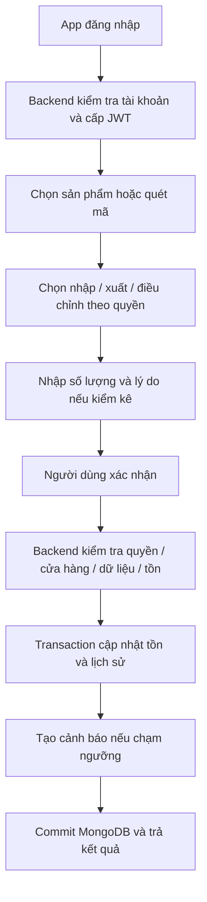

# NGHIỆP VỤ HIỆN TẠI – INVENTORY SUPPORT

> **Sản phẩm:** Ứng dụng hỗ trợ quản lý sản phẩm, nhập/xuất và kiểm kê hàng hóa cho cửa hàng nhỏ.
> **Phiên bản tài liệu:** 1.2 — cập nhật 15/11/2026.
> **Căn cứ:** Mã nguồn trong workspace hiện tại, bao gồm các thay đổi chưa commit.
> **Trạng thái:** Mô tả chức năng đã có trong mã; không phải xác nhận mọi luồng đã nghiệm thu trên thiết bị thật.

## 1. Mục tiêu và phạm vi

Inventory Support giúp cửa hàng tra cứu tồn, quản lý sản phẩm, ghi nhận nhập/xuất/điều chỉnh, theo dõi lịch sử và nhận cảnh báo hàng sắp hết. Ứng dụng hỗ trợ quét barcode/QR, xử lý ảnh sản phẩm và phiếu nhập, chuẩn hóa thông tin và trợ lý AI để giảm nhập liệu.

Phạm vi hiện tại gồm tài khoản, bốn vai trò cố định, sản phẩm, nhập/xuất/kiểm kê trực tiếp một hoặc nhiều sản phẩm, thống kê, thông báo và AI. Mỗi sản phẩm có một đơn vị tồn kho cơ bản. Dữ liệu nghiệp vụ gắn `storeId`; luồng đăng ký và dữ liệu mẫu hiện dùng `store-1`, chưa có chức năng quản trị nhiều cửa hàng hoàn chỉnh.

**Chưa triển khai:** phiên kiểm kê có phân công, lưu bản đếm riêng, gửi duyệt, phê duyệt hoặc khóa nhập/xuất theo phiên; quy đổi đơn vị, nhiều kho, lô/hạn sử dụng, đồng bộ offline và hệ thống POS/kế toán đầy đủ. Không dùng các nghiệp vụ này làm tiêu chí đã hoàn thành.

## 2. Người dùng và phân quyền

Nguồn chuẩn: `Server/backend/src/common/permissions.ts` và `common/types.ts`. Quyền được xác định theo vai trò cố định, chưa có cấp quyền tùy chỉnh cho từng người.

| Chức năng/quyền | ADMIN | MANAGER | STAFF | VIEWER |
| --- | --- | --- | --- | --- |
| Xem sản phẩm — `PRODUCT_VIEW` | Có | Có | Có | Có |
| Thêm/sửa/xóa mềm sản phẩm | Có | Có | Không | Không |
| Nhập kho — `STOCK_IMPORT` | Có | Có | Không | Không |
| Xuất kho — `STOCK_EXPORT` | Có | Có | Có | Không |
| Kiểm kê điều chỉnh — `STOCK_ADJUST` | Có | Có | Không | Không |
| Xem màn báo cáo — `REPORT_VIEW` | Có | Có | Không | Có |
| Quản lý tài khoản — `USER_MANAGE` | Có | Không | Không | Không |
| Dùng AI — `AI_USE` | Có | Có | Có | Không |
| Nhận/xem cảnh báo tồn kho | Có | Có | Không | Không |

Backend kiểm tra JWT và quyền; việc ẩn nút ở mobile không thay thế kiểm tra backend. Nhập/xuất/điều chỉnh được kiểm quyền theo `type` trong `InventoryService`. Quét phiếu nhập AI yêu cầu cả `AI_USE` và `STOCK_IMPORT`.

**Điểm cần phân biệt khi đánh giá bảo mật:** `GET /inventory/summary` hiện yêu cầu `PRODUCT_VIEW`, không phải `REPORT_VIEW`; vì vậy STAFF vẫn có thể gọi API tổng hợp dù không có tab Báo cáo. Một số kết quả AI ẩn `costPrice` theo quyền, nhưng không được suy ra toàn bộ API sản phẩm/tổng hợp đã che dữ liệu giá nhập. Đây là hiện trạng cần rà soát riêng, không phải quyền mới được tài liệu cấp thêm.

## 3. Các nghiệp vụ hiện có

### 3.1. Tài khoản

- Đăng nhập bằng email/mật khẩu; tài khoản phải đang hoạt động.
- Đăng ký công khai tạo tài khoản `STAFF`, `active: false`, chờ ADMIN kích hoạt; không tự cấp quyền quản lý.
- ADMIN quản lý tài khoản trong cửa hàng, cập nhật vai trò/trạng thái theo các kiểm tra của service.
- Người dùng xem hồ sơ, đổi mật khẩu và đăng xuất ở app. JWT hiện có thời hạn 8 giờ; đăng xuất phía app không tương đương thu hồi token trên server.
- Mật khẩu được băm bằng `scrypt` với salt ngẫu nhiên; JWT dùng `jsonwebtoken` và guard tự viết.

### 3.2. Sản phẩm

- ADMIN/MANAGER tạo, sửa, xóa mềm sản phẩm; tất cả vai trò xem và tìm sản phẩm.
- Trường chính: `id`, `storeId`, `barcode`, `name`, `normalizedName`, `description`, `category`, `unit`, `price`, `costPrice`, `supplier`, `minStock`, `quantity`, `imageUrl`, thời gian tạo/sửa và `deletedAt` nếu bị xóa.
- Không có trường SKU độc lập. Barcode tự sinh khi không nhập; kiểm tra duy nhất trong các sản phẩm đang hoạt động của cửa hàng.
- Sản phẩm mới có tồn bằng 0; cập nhật thông tin sản phẩm không trực tiếp đổi tồn. Nhập kho qua nghiệp vụ kho.
- Danh mục và nhà cung cấp là chuỗi trong sản phẩm; danh sách danh mục lấy từ sản phẩm, chưa có module CRUD danh mục riêng.
- Khi xóa mềm, giữ lịch sử và thay barcode của bản ghi đã xóa để giải phóng mã cho sản phẩm mới.
- Có tìm kiếm bỏ dấu, tra barcode/QR, tạo nhãn sản phẩm và nhập sản phẩm từ Excel qua tiện ích trong app.

### 3.3. Nhập, xuất và kiểm kê trực tiếp

Loại giao dịch đúng trong mã: `IMPORT`, `EXPORT`, `ADJUSTMENT`.

| Loại | Dữ liệu người dùng nhập | Tồn sau thao tác |
| --- | --- | --- |
| `IMPORT` | Số nguyên dương cần nhập | Tồn trước + số nhập |
| `EXPORT` | Số nguyên dương cần xuất | Tồn trước - số xuất; chặn vượt tồn |
| `ADJUSTMENT` | Số nguyên không âm thực đếm và lý do bắt buộc | Đặt tồn bằng số thực đếm |

Mỗi thao tác ghi lịch sử gồm sản phẩm, người thao tác, loại, số lượng trước/sau và thời gian. Với ADJUSTMENT, `quantity` trong lịch sử là chênh lệch sau trừ trước, có thể âm hoặc bằng 0.

Luồng kiểm kê hiện tại: ADMIN/MANAGER chọn sản phẩm → nhập số thực đếm → ghi lý do → xác nhận → cập nhật tồn và ghi lịch sử ngay. Không có người phê duyệt riêng hoặc trạng thái chờ duyệt.

Ví dụ tồn 120 cây, thực đếm 113: gửi `ADJUSTMENT` với `quantity: 113`; lịch sử ghi `quantity: -7`, `quantityBefore: 120`, `quantityAfter: 113`.

Batch nhận tối đa 200 dòng cùng loại, không cho trùng sản phẩm và kiểm tra toàn bộ dòng trước khi áp dụng. Mã đã chuyển sang MongoDB transaction; kiểm chứng đồng thời trên replica set thật còn chờ cấu hình môi trường.

### 3.4. Quét và AI

Luồng xử lý chi tiết, quyền từng nhánh, bước xác nhận và xử lý lỗi được mô tả tại [AI_ASSISTANT.md](docs/AI_ASSISTANT.md), bám theo các quy tắc nghiệp vụ trong tài liệu này.

- Camera quét barcode/QR để tra sản phẩm; khi không nhận diện được có thể tìm hoặc nhập thủ công.
- Chuẩn hóa văn bản, nhận diện ảnh sản phẩm và đọc phiếu nhập dùng Gemini qua backend. Người dùng xem và duyệt gợi ý trước khi lưu.
- Đọc phiếu nhập không tự ghi kho; người dùng kiểm tra sản phẩm, đơn vị và số lượng rồi xác nhận thao tác kho theo quyền.
- Trợ lý dùng công cụ backend để tra dữ liệu thật và tạo đề xuất. Việc người dùng xác nhận thẻ thao tác mới gọi API nghiệp vụ; bước đồng bộ xác nhận của trợ lý đối chiếu giao dịch đã lưu, không ghi giao dịch lần nữa.
- Các luồng AI chính hiện dùng `GEMINI_API_KEY`, model từ `AI_MODEL` (mặc định trong mã: `gemini-3.5-flash-lite`). Đây là giá trị cấu hình mã nguồn, không xác nhận model khả dụng với mọi tài khoản.
- Thiếu key, quota hoặc lỗi nhà cung cấp phải báo lỗi và cho thao tác thủ công; không mô tả luồng chính là tự chuyển sang model offline. File Claude/offline cũ còn trong repo không có nghĩa đang là provider chính.
- Phiên trợ lý hiện ở RAM, không thuộc dữ liệu JSON bền vững; khởi động lại backend có thể mất phiên.

### 3.5. Thông báo và thống kê

- Cảnh báo `LOW_STOCK`/`OUT_OF_STOCK` dành cho ADMIN/MANAGER cùng cửa hàng; lưu trạng thái đọc theo người dùng và hỗ trợ Expo push khi có token.
- Cảnh báo phát sinh khi tồn vừa vượt ngưỡng xuống mức thấp hoặc từ còn hàng về 0, tránh tạo lại sau mọi lần xuất.
- Có dashboard, lịch sử giao dịch và thống kê theo khoảng thời gian: lượng nhập/xuất, tồn, giá trị kho, hàng sắp hết và sản phẩm xuất nhiều.
- Doanh thu xuất hiện tại được tính theo giá bán hiện tại của sản phẩm, không phải giá bán snapshot ở giao dịch; không xem là báo cáo kế toán/doanh thu lịch sử chính xác khi giá thay đổi.

## 4. Luồng hoạt động hiện tại

Mã sử dụng MongoDB transaction cho tồn/lịch sử/cảnh báo; push gửi sau commit. Chưa chạy integration trên replica set trong môi trường hiện tại.

## 5. Quy tắc nghiệp vụ

1. Dữ liệu nghiệp vụ được tra cứu theo cửa hàng của người đăng nhập.
2. Barcode phải duy nhất giữa sản phẩm đang hoạt động trong cùng cửa hàng; không có quy tắc SKU riêng.
3. Nhập/xuất dùng số nguyên dương; kiểm kê cho phép 0 và bắt buộc lý do.
4. Không xuất vượt tồn; chỉ ADMIN/MANAGER được kiểm kê và nhập kho.
5. Thay đổi tồn qua API kho phải ghi lịch sử; tạo sản phẩm mới không tự nhập tồn.
6. Batch cùng loại, tối đa 200 dòng, không trùng sản phẩm; lỗi validation một dòng ngăn áp dụng cả batch.
7. Xóa sản phẩm là xóa mềm, giữ liên hệ tới lịch sử.
8. AI chỉ hỗ trợ tra cứu/đề xuất; backend vẫn kiểm tra quyền và nghiệp vụ trước ghi dữ liệu.
9. Chưa có khóa hàng theo phiên kiểm kê hoặc quy trình người đếm/người duyệt riêng.
10. Không suy ra API kho hiện có cơ chế chống ghi lặp cho mọi yêu cầu gửi lại khi mất mạng.

## 6. Màn hình và điều hướng

Nguồn: `App/InventorySupport/src/navigation/AppNavigator.tsx`.

| Màn hình/nhóm | Mục đích |
| --- | --- |
| Đăng nhập, đăng ký | Xác thực và gửi yêu cầu tạo tài khoản |
| Tổng quan | Dashboard và lối tắt |
| Sản phẩm, chi tiết, form | Tìm, xem và quản lý sản phẩm theo quyền |
| Nhập / xuất hoặc Xuất kho | Hiện khi có ít nhất một quyền thao tác kho; gồm kiểm kê theo quyền |
| Quét | Tra barcode/QR và các luồng quét được phép |
| Báo cáo | Tab hiển thị khi có `REPORT_VIEW` |
| Tài khoản, đổi mật khẩu | Hồ sơ và quản lý phiên phía app |
| Thông báo | Danh sách cảnh báo theo vai trò |
| Trợ lý AI | Chat và chuẩn hóa/gợi ý theo quyền |
| Quản lý tài khoản, form tài khoản | ADMIN |

Chưa có màn danh sách phiên kiểm kê, phân công hoặc phê duyệt phiên.

## 7. Lưu trữ dữ liệu hiện tại

Backend đã đổi mã sang MongoDB/Mongoose qua `DatabaseService`, bắt buộc `MONGODB_URI`; không đọc `DATA_FILE`, tự seed hoặc fallback JSON. Môi trường hiện chặn cài package nên chưa xác minh build/kết nối Atlas thật; unit và HTTP contract test dùng fixture riêng trong test. Bộ mẫu mới không chuyển dữ liệu JSON cũ.

| Collection MongoDB | Nội dung |
| --- | --- |
| `users` | Người dùng, role, storeId, passwordHash, active, pushTokens và timestamps |
| `products` | Sản phẩm, giá, tồn hiện tại, danh mục dạng chuỗi, đường dẫn ảnh và xóa mềm |
| `transactions` | Lịch sử `IMPORT`/`EXPORT`/`ADJUSTMENT`, tên sản phẩm/người thao tác và số lượng trước/sau |
| `notifications` | Cảnh báo theo cửa hàng và danh sách user đã đọc |

ID là chuỗi (`product-…`, `user-…`), timestamps là ISO string. Tồn hiện tại nằm ở `Product.quantity`, không có `inventory_balances`, `stocktake_sessions` hoặc `stocktake_items`. `_id` chuỗi được ánh xạ thành `id` trong response API.

Ảnh nằm ở `UPLOAD_DIR` (mặc định `uploads`), URL tương đối `/uploads/<storeId>/<file>`. Backend phục vụ file tĩnh; sao lưu dữ liệu phải kèm thư mục ảnh. URL file tĩnh hiện không đi qua JWT như các API nghiệp vụ.

## 8. Công nghệ thực tế trong repository

Phiên bản dưới đây là khoảng phiên bản khai báo trong package.json, không phải cam kết về phiên bản mới nhất hoặc mọi package đã được chạy thử trên thiết bị.

| Thành phần | Công nghệ hiện có |
| --- | --- |
| Mobile | React Native `0.86.3`, React `19.2.3`, Expo `~57.0.32`, TypeScript |
| Điều hướng / trạng thái | React Navigation 7; context/store và hooks của app |
| Backend | NestJS `^12.0.1`, TypeScript, ESM, Express adapter |
| Lưu dữ liệu | MongoDB Atlas qua Mongoose; ảnh local filesystem; phiên AI RAM |
| Xác thực | `jsonwebtoken`, JwtAuthGuard, PermissionsGuard, băm mật khẩu scrypt |
| Kiểm tra đầu vào | Hàm validation tự viết trong `src/common/validation.ts`; DTO mô tả dữ liệu |
| AI chính | `@google/genai`; SDK Anthropic còn là dependency/mã cũ |
| Camera/ảnh | `expo-camera`, `expo-image-picker`; upload base64 qua API backend |
| Phiên đăng nhập | `expo-secure-store` trên native và triển khai lưu phiên riêng cho web |
| Thông báo | `expo-notifications` và Expo Push API |
| Excel / nhãn | `xlsx`, `expo-document-picker`, `qrcode` |
| Kiểm thử backend | Vitest, Supertest, Nest testing |
| Kiểm tra mã | Backend Oxlint; app Expo ESLint; TypeScript |

Đã khai báo `@nestjs/mongoose` và `mongoose` trong package.json, nhưng môi trường chưa tải/cài được package và lockfile cần cập nhật bằng npm install. Chưa có Passport, `class-validator`, `class-transformer` hoặc Swagger. Postman có thể dùng kiểm tra thủ công, không thay thế bộ test tự động hiện có.

Backend hiện lắng nghe `0.0.0.0`, mặc định cổng 3000, phục vụ HTTP. App cấu hình backend qua `EXPO_PUBLIC_API_URL`; chưa thể mô tả hệ thống đang được triển khai HTTPS hoặc APK phát hành đã kiểm chứng.

## 9. Module và API hiện có

Module nghiệp vụ: `AuthModule`, `UsersModule`, `ProductsModule`, `InventoryModule`, `NotificationsModule`, `UploadsModule`, `AiModule`, cùng `DatabaseModule`. Chưa có `CategoriesModule`, `StocktakeModule` hoặc `ReportsModule` độc lập; thống kê thuộc Inventory.

| Nhóm | Endpoint tiêu biểu |
| --- | --- |
| Auth | `POST /auth/login`, `POST /auth/register`, `GET /auth/me`, `POST /auth/change-password` |
| Users | `GET/POST /users`, `PATCH/DELETE /users/:id` |
| Products | `GET/POST /products`, `GET /products/categories`, `GET /products/resolve`, `GET /products/barcode/:barcode`, `GET /products/:id/label`, `GET/PATCH/DELETE /products/:id` |
| Inventory | `POST /inventory/movement`, `POST /inventory/batch`, `GET /inventory/low-stock`, `GET /inventory/transactions`, `GET /inventory/summary` |
| Notifications | `GET /notifications`, `GET /notifications/unread-count`, `POST /notifications/read-all`, `POST /notifications/:id/read`, `POST /notifications/push-token` |
| Uploads | `POST /uploads/image` |
| AI | `GET /ai/status`, `POST /ai/normalize-product`, `POST /ai/scan-image`, `POST /ai/scan-invoice` |
| Assistant | Các route chat/session/confirm thuộc controller trợ lý trong `src/ai/assistant/assistant.controller.ts` |

## 10. Kiểm chứng và giới hạn

Tiêu chí kiểm chứng chức năng hiện có: đăng nhập/kích hoạt/khóa tài khoản đúng, chặn thao tác sai role hoặc khác cửa hàng, CRUD sản phẩm và barcode đúng, không xuất vượt tồn, kiểm kê 0 hợp lệ có lý do, lịch sử trước/sau khớp, batch lỗi không áp dụng dòng hợp lệ trước đó, cảnh báo theo ngưỡng và AI không tự ghi khi chưa duyệt.

Các bảo đảm cần đánh giá riêng khi chuyển database: ghi đồng thời, rollback khi lỗi lưu, tính nhất quán tồn/lịch sử/thông báo và chống ghi lặp. Mã transaction đã có; integration tests cần MONGODB_TEST_URI cho replica set riêng.

Tài liệu cập nhật bằng đối chiếu mã nguồn, không chạy lại test, build APK, đo hiệu năng hay gọi Gemini thật. Bộ ca AI tham khảo `docs/AI_NORMALIZATION_EVAL.md`; kết quả mock không chứng minh chất lượng model với ảnh thật.

## 11. Tiến độ chuyển MongoDB và bộ mẫu

Người dùng đã chọn bắt đầu với **APK và backend cùng Wi-Fi + MongoDB Atlas Free + ảnh trên máy tính**. Backend NestJS kết nối Atlas qua Internet; điện thoại gọi backend qua IP LAN, không chứa URI hoặc tài khoản MongoDB.

Thiết kế đã duyệt, mã và fixtures đã được chuẩn bị cho: công nghệ và phiên bản tương thích, cấu trúc file, chuyển toàn bộ caller sang I/O bất đồng bộ, bốn collection tương ứng dữ liệu hiện tại, transaction kho, hướng dẫn tự setup Atlas/LAN/APK, sao lưu và bộ dữ liệu giả một tháng kèm ảnh. Đã chọn siêu thị mini và bỏ dữ liệu cũ; bộ mẫu đã tạo gồm 60 sản phẩm, 6 tài khoản, 629 giao dịch trong 30 ngày, 15 cảnh báo, 60 ảnh và 3 phiếu mẫu. APK để sau theo yêu cầu mới.

Tài liệu kế hoạch sơ bộ: `docs/superpowers/plans/2026-11-15-mongodb-atlas-migration.md`. Đây là phương án đề xuất, không phải cấu hình đã triển khai. Phiên kiểm kê có phê duyệt, kho riêng, cloud ảnh và offline chỉ mở rộng khi được yêu cầu và thiết kế tiếp.

## 12. Nguồn đối chiếu

- `Server/backend/src/common/types.ts`, `common/permissions.ts`, `common/validation.ts`, `common/password.ts`.
- `Server/backend/src/database/database.service.ts`.
- Các controller/service trong `auth`, `users`, `products`, `inventory`, `notifications`, `uploads`, `ai`.
- `Server/backend/src/main.ts`, `Server/backend/package.json`.
- `App/InventorySupport/package.json`, `src/navigation/AppNavigator.tsx`.
- `docs/PROJECT_PROGRESS.md`, `docs/AI_GEMINI_MIGRATION_REPORT.md`.
