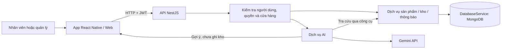

# Inventory Support

> Tài liệu nghiệp vụ và vận hành cập nhật theo mã hiện tại, ngày 16/11/2026. Bán lẻ được ghi nhận bằng xuất kho cuối ca/ngày; không mở rộng sang POS/ERP.

Ứng dụng mobile (Expo / React Native, chạy được cả trên web) hỗ trợ cửa hàng nhỏ
kiểm kê sản phẩm: quét mã vạch / quét ảnh bằng AI, theo dõi nhập - xuất - tồn,
cảnh báo tồn kho thấp và chuẩn hóa mô tả sản phẩm bằng AI.

## Chạy nhanh: Expo Go hoặc APK trên điện thoại thật

Các lệnh bên dưới dùng PowerShell. Cần Node.js/npm, Internet và cấu hình MongoDB
trong `Server/backend/.env` (xem [Chạy backend](#chạy-backend)). Máy clone mới chạy
`npm ci` một lần trong từng thư mục `Server/backend` và `App/InventorySupport`.
Không seed lại database đang có dữ liệu chỉ để khởi động ứng dụng.

| Cách chạy | Cần mở trên laptop | Cần trên điện thoại |
| --- | --- | --- |
| Expo Go + ngrok | Backend, ngrok và Metro/Expo | Expo Go tương thích SDK 57; cùng Wi-Fi với Metro khi dùng `--lan` |
| APK đã cài + ngrok | Backend và ngrok | APK và Internet; có thể dùng Wi-Fi khác hoặc 4G/5G |

### 1. Chạy backend và kết nối ngrok (dùng cho cả hai cách)

Terminal 1 — backend:

```powershell
cd D:\SE_Nam4\ReactNative\Project\InventorySupport\Server\backend
node --env-file=.env node_modules/@nestjs/cli/bin/nest.js start --watch
```

Terminal 2 — ngrok:

```powershell
ngrok http 3000
```

Nếu máy chưa có ngrok: cài CLI từ [trang tải ngrok](https://ngrok.com/download),
đăng nhập tài khoản ngrok rồi lưu authtoken một lần bằng lệnh sau; thay placeholder
bằng token riêng, không đưa token vào repo:

```powershell
ngrok config add-authtoken "3MBob6l4n4TibP1uGYK8foccMbq_4RejauYUPd6orSpQJt6j5"
```

Kiểm tra dòng `Forwarding` trỏ từ **https://defeat-city-childless.ngrok-free.dev**
tới `http://localhost:3000`. Domain này thuộc tài khoản ngrok đang dùng; tài khoản
khác phải dùng domain được cấp cho mình và cập nhật URL app tương ứng.
Xem [hướng dẫn chính thức của ngrok](https://ngrok.com/docs/start).

Mở `https://defeat-city-childless.ngrok-free.dev/health` trên điện thoại:
kết quả phải là JSON có `status: "ok"`, không chỉ trang HTML/HTTP 200.
API và ảnh sản phẩm `/uploads/...` cùng đi qua domain này. Giữ cả hai terminal
chạy và laptop không sleep trong suốt lúc dùng app.

Trước khi mở backend ra Internet, đặt `JWT_SECRET` riêng và đổi mật khẩu demo
công khai bằng chức năng tài khoản/quản trị. URI MongoDB, key AI và authtoken ngrok
chỉ lưu phía backend/máy cá nhân, không đưa vào biến `EXPO_PUBLIC_*`.

### 2. Chạy app bằng Expo Go

Tạo hoặc kiểm tra `App/InventorySupport/.env.local` (file local, không commit):

```dotenv
EXPO_PUBLIC_API_URL=https://defeat-city-childless.ngrok-free.dev
```

Terminal 3 — app:

```powershell
cd D:\SE_Nam4\ReactNative\Project\InventorySupport\App\InventorySupport
npx expo start --lan --clear
```

Cài Expo Go tương thích SDK 57, cho điện thoại và laptop dùng cùng Wi-Fi rồi quét
QR trong terminal. Màn đăng nhập phải hiển thị URL HTTPS ngrok. Đăng nhập bằng
tài khoản đang hoạt động để thử danh sách, ảnh sản phẩm và nghiệp vụ kho.

Nếu cần tải app qua mạng khác, có thể dùng `npx expo start --tunnel --clear` thay
cho `--lan` và làm theo yêu cầu cài tunnel của Expo CLI. Tunnel Expo phục vụ Metro;
ngrok ở terminal 2 phục vụ backend. Cần giữ cả hai hoạt động.
Xem [Expo CLI](https://docs.expo.dev/more/expo-cli/).

Sau khi đổi `.env.local`, khởi động lại Expo. Nếu terminal đã đặt
`EXPO_PUBLIC_API_URL` khác, bỏ biến đó hoặc dùng terminal mới để tránh ghi đè URL.

### 3. Chạy bằng APK cài trên điện thoại Android thật

Sau khi EAS build thành công:

1. Mở link build EAS trên điện thoại, tải file `.apk` từ phần artifact của build.
2. Cho phép trình duyệt/trình quản lý file cài ứng dụng từ nguồn đó nếu Android yêu cầu,
   rồi mở APK và cài **InventorySupport**.
3. Chạy backend và ngrok theo bước 1. Điện thoại có Internet là có thể gọi API,
   không bắt buộc cùng Wi-Fi với laptop.
4. Mở app trực tiếp từ màn hình điện thoại, đăng nhập và cấp quyền camera/ảnh khi cần.
   Không cần Expo Go, quét QR hoặc chạy `expo start`.
5. Kiểm tra đăng nhập, danh sách/ảnh sản phẩm, quét mã, lịch sử và phiên kiểm kê.
   Khi thử nhập/xuất, dùng dữ liệu thử phù hợp và đối chiếu lịch sử sau thao tác.

APK chỉ đóng gói ứng dụng mobile; backend và MongoDB vẫn chạy riêng. Nếu ngắt mạng
ngay sau thao tác ghi kho, kiểm tra lịch sử trước khi gửi lại để tránh ghi trùng.

## Build APK bằng EAS

**Trạng thái ngày 16/11/2026:** theo thông tin người thực hiện, đã gửi build Android
và đang ở trạng thái **Queued** (chờ hàng đợi EAS). Chưa xác nhận build thành công,
chưa có kết quả nghiệm thu APK trên điện thoại thật. Không cần gửi thêm build
trong lúc chờ; theo dõi trang build từ link CLI đã trả về.

Cấu hình đã có trong repo:

- `App/InventorySupport/app.json`: package Android `com.inventorysupport.app`,
  cấu hình quyền/plugin native và `extra.eas.projectId` liên kết project EAS.
- `App/InventorySupport/eas.json`: profile `preview`, `distribution: "internal"`,
  môi trường `preview`, `android.buildType: "apk"` và
  `EXPO_PUBLIC_API_URL=https://defeat-city-childless.ngrok-free.dev`.
- `.env.local` dùng cho Expo local; cloud build dùng URL cấu hình trong profile EAS.

Quy trình dùng để thiết lập và gửi build (tham khảo cho lần build tiếp theo):

```powershell
cd D:\SE_Nam4\ReactNative\Project\InventorySupport\App\InventorySupport
npm run lint
npx tsc --noEmit
npx expo install --check
npx expo-doctor
npx eas-cli@latest login
npx eas-cli@latest build:configure
npx eas-cli@latest build --platform android --profile preview
```

`login`/`build:configure` dùng khi thiết lập lần đầu hoặc đổi tài khoản/cấu hình;
không phải chạy lại cho mỗi build nếu đã đăng nhập và liên kết đúng project.
Khi thiết lập lần đầu, chọn Android và cho EAS tạo keystore nếu chưa có.
Giữ cùng package/keystore khi cập nhật APK đã cài; giữ nguyên profile `preview`
và URL API khi EAS bổ sung cấu hình.

Nếu Doctor báo lệch patch, dùng `npx expo install --fix` rồi kiểm tra lại trước
build tiếp theo. Lỗi `Directory check failed with unexpected server response`
nghĩa là chưa hoàn tất kiểm tra metadata từ React Native Directory; chạy lại
`npx expo-doctor --verbose` để xem chi tiết, không coi đó là xác nhận package lỗi.

Khi EAS báo build thành công, tải artifact `.apk` và cài theo phần trên.
Profile này tạo APK cài trực tiếp, không phải AAB để phát hành Google Play.
Tham khảo [hướng dẫn build/cài APK của Expo](https://docs.expo.dev/build-reference/apk/).

URL API được đóng vào APK lúc build. Nếu đổi domain ngrok, cập nhật
`EXPO_PUBLIC_API_URL` trong `.env.local` và profile `preview` của `eas.json`,
kiểm tra cấu hình môi trường EAS không có URL khác, rồi build/cài APK mới.
Chỉ đổi Wi-Fi laptop mà domain giữ nguyên thì không cần build lại; khởi động lại
backend/tunnel nếu cần và kiểm tra Atlas cho phép IP mạng mới.
Ngrok có quota và không thay thế máy chủ hosting hoạt động liên tục.
Chi tiết kiểm tra kết nối: [NGROK_SETUP.md](docs/NGROK_SETUP.md).

## Cấu trúc project

```text
InventorySupport/
├── App/InventorySupport/              # Expo SDK 57, React Native, React Navigation
│   ├── App.tsx                       # Khởi tạo ứng dụng và các provider
│   ├── index.ts                      # Entry point đăng ký ứng dụng Expo
│   ├── app.json                      # Cấu hình Expo, Android package, plugin và EAS projectId
│   ├── eas.json                      # Profile preview: APK và URL backend ngrok
│   ├── .env.local                    # URL API cho Expo local, không commit
│   ├── assets/                       # Icon, splash và tài nguyên ứng dụng
│   ├── package.json                  # Dependency và lệnh start/lint
│   └── src/
│       ├── navigation/               # Điều hướng đăng nhập, các tab và màn chi tiết
│       ├── screens/
│       │   ├── auth/                 # Đăng nhập, đăng ký
│       │   ├── dashboard/            # Tổng quan kho
│       │   ├── products/             # Danh sách, chi tiết, form sản phẩm
│       │   ├── inventory/            # Nhập, xuất, kiểm kê
│       │   ├── scanner/              # Quét mã, quét liên tục, ảnh và phiếu nhập
│       │   ├── ai/                   # Hỏi đáp kho, chuẩn hóa và thẻ đề xuất
│       │   ├── reports/              # Báo cáo nhập–xuất–tồn
│       │   ├── notifications/        # Thông báo tồn kho
│       │   ├── users/                # Quản lý nhân viên
│       │   └── account/              # Tài khoản, đổi mật khẩu
│       ├── components/               # UI dùng chung, thẻ sản phẩm, AiSuggestionCard
│       ├── services/                 # Gọi API, upload và ánh xạ gợi ý AI vào form
│       ├── store/                    # Trạng thái đăng nhập, chat, thông báo
│       ├── hooks/                    # Phân trang, tải lại khi mở màn hình
│       ├── types/                    # Kiểu dữ liệu và contract API phía app
│       ├── constants/                # Địa chỉ API, quyền, theme
│       └── utils/                    # Định dạng, hộp thoại, nhập Excel
├── Server/backend/                   # NestJS 12, TypeScript ESM
│   ├── src/
│   │   ├── main.ts                   # Khởi động API, CORS, phục vụ ảnh upload
│   │   ├── app.module.ts             # Ghép các module và Observe
│   │   ├── auth/                     # JWT, đăng nhập và guards phân quyền
│   │   ├── users/                    # Tài khoản và vai trò
│   │   ├── products/                 # Sản phẩm, barcode/QR, đối chiếu ứng viên
│   │   ├── inventory/                # Kiểm tra và lưu giao dịch kho
│   │   ├── stocktakes/               # Phiên kiểm kê, số thực đếm và hoàn tất
│   │   ├── ai/
│   │   │   ├── ai.service.ts         # Chuẩn hóa, điều phối Gemini và lỗi
│   │   │   ├── gemini-product-vision.ts # Prompt, schema và adapter Gemini
│   │   │   └── assistant/            # Hội thoại, công cụ tra kho, phiên và đề xuất
│   │   ├── uploads/                  # Kiểm tra, lưu ảnh theo cửa hàng
│   │   ├── notifications/            # Cảnh báo tồn kho và push
│   │   ├── database/                 # MongoDB/Mongoose, fixture riêng cho test
│   │   └── common/                   # Kiểu dữ liệu, quyền, validation
│   ├── test/                         # Kiểm thử E2E API; unit test nằm cạnh source
│   ├── scripts/                      # Tạo/kiểm tra/thay dữ liệu demo và ảnh
│   ├── .env                          # MongoDB, JWT, key AI; file local, không commit
│   ├── fixtures/minimart247/         # Bộ hiện dùng: 65 sản phẩm, 65 ảnh, nguồn và dữ liệu mô phỏng
│   ├── fixtures/mini-mart/           # Fixture cũ phục vụ script/test, không phải bộ đang chạy
│   └── uploads/                      # Ảnh mặc định, tạo khi tải ảnh lên
└── docs/                             # Hướng dẫn, thiết kế và kết quả kiểm tra
    ├── NGROK_SETUP.md                # Kết nối ngrok, kiểm tra API/ảnh và build APK
    ├── MONGODB_LOCAL_SETUP.md        # Thiết lập MongoDB cho môi trường local
    ├── DEMO_DATA.md                  # Nguồn và cách quản lý dữ liệu demo
    ├── PROJECT_PROGRESS.md           # Tiến độ và giới hạn đã xác minh
    ├── SCAN.md                       # Luồng quét mã/ảnh và kiểm kê
    └── superpowers/                  # Tài liệu kế hoạch và thiết kế thay đổi
```

## Kiến trúc và luồng nghiệp vụ



Backend là nơi kiểm tra dữ liệu, quyền và số tồn; app chịu trách nhiệm nhập liệu, hiển thị
kết quả và nhận xác nhận. AI không truy cập file dữ liệu trực tiếp và không tự ghi kho.

## Nghiệp vụ hệ thống

### 1. Phạm vi và nguyên tắc

Hệ thống hỗ trợ cửa hàng nhỏ quản lý **sản phẩm – nhập hàng – xuất hàng/bán lẻ cuối ca – kiểm kê – lịch sử – cảnh báo – báo cáo**. AI hỗ trợ nhập liệu và tra cứu, không thay người dùng quyết định ghi kho. Phạm vi đồ án không bao gồm POS, ERP, hóa đơn thanh toán hoặc kế toán.

- Mọi dữ liệu nghiệp vụ gắn `storeId`; backend lấy cửa hàng từ tài khoản đăng nhập, không tin cửa hàng/quyền do client tự gửi.
- Mỗi sản phẩm có một đơn vị tồn cơ bản. Một “lốc”, “chai” hay “thùng” là đơn vị khác nhau; hệ thống không tự quy đổi. Bán theo đơn vị khác cần quy đổi và kiểm tra bên ngoài trước khi nhập số vào app, hoặc quản lý thành quy cách sản phẩm riêng.
- `products.quantity` là tồn hiện tại. Mọi thay đổi tồn qua nghiệp vụ kho ghi lịch sử trước/sau và tăng `stockVersion` để phát hiện xung đột kiểm kê.
- App cung cấp form và xác nhận; backend kiểm tra quyền, dữ liệu, cửa hàng, số tồn và lưu transaction. Ẩn nút trên app không thay thế phân quyền backend.
- Danh mục, đơn vị và nhà cung cấp là trường trong sản phẩm; chưa có module danh mục/nhà cung cấp, mua hàng hoặc công nợ độc lập.

### 2. Tài khoản, phiên đăng nhập và phân quyền

Đăng nhập yêu cầu email/mật khẩu đúng và tài khoản đang hoạt động. Đăng ký công khai tạo `STAFF`, `active=false`; ADMIN phải kích hoạt trước khi đăng nhập. Người dùng được xem hồ sơ, đổi mật khẩu và đăng xuất.

ADMIN quản lý tài khoản cùng cửa hàng: tạo, sửa thông tin, đặt vai trò, kích hoạt/khóa và xóa theo các kiểm tra của service. Không được tự hạ quyền, tự khóa/xóa tài khoản đang dùng; cửa hàng phải còn ít nhất một ADMIN hoạt động. Xóa tài khoản không đồng nghĩa xóa lịch sử kho đã có.

JWT có thời hạn 8 giờ; backend đọc lại tài khoản trên mỗi request để cập nhật quyền/trạng thái. App lưu token bằng SecureStore trên Android/iOS hoặc localStorage trên web, không lưu mật khẩu. Khi mở app, gọi `/auth/me` để khôi phục quyền; lỗi mạng cho thử lại, token hết hạn hoặc không hợp lệ yêu cầu đăng nhập lại. Đăng xuất phía app xóa phiên local, chưa phải cơ chế thu hồi mọi JWT trên server.

| Nghiệp vụ | ADMIN | MANAGER | STAFF | VIEWER |
| --- | :---: | :---: | :---: | :---: |
| Xem/tìm sản phẩm, tra barcode/QR | Có | Có | Có | Có |
| Tạo/sửa/xóa mềm, nhập danh mục sản phẩm từ Excel | Có | Có | Không | Không |
| Nhập kho | Có | Có | Không | Không |
| Xuất kho/ghi nhận bán lẻ cuối ca | Có | Có | Có | Không |
| Điều chỉnh tồn, tạo/lưu/chốt/hủy phiên kiểm kê của mình | Có | Có | Không | Không |
| Tab Báo cáo | Có | Có | Không | Có |
| Chuẩn hóa/chat/nhận diện ảnh AI | Có | Có | Có | Không |
| Đọc phiếu nhập AI và nhập kho sau duyệt | Có | Có | Không | Không |
| Xem/đánh dấu đã đọc cảnh báo tồn | Có | Có | Không | Không |
| Quản lý tài khoản | Có | Không | Không | Không |

Nguồn chuẩn: `Server/backend/src/common/permissions.ts`. Lưu ý hiện trạng: `/inventory/summary` yêu cầu `PRODUCT_VIEW`, nên STAFF vẫn gọi được API tổng hợp dù app không hiện tab Báo cáo. Không suy ra rằng toàn bộ API sản phẩm/tổng hợp đã che giá nhập; một số kết quả ứng viên AI có lọc `costPrice` riêng theo quyền.

### 3. Quản lý sản phẩm và dữ liệu đầu vào

- Thông tin chính: tên/tên chuẩn hóa, barcode hoặc mã nội bộ, mô tả, danh mục, đơn vị, giá bán, giá nhập, nhà cung cấp, ngưỡng tồn tối thiểu và ảnh.
- Tất cả vai trò được tìm kiếm không dấu theo tên/barcode, lọc danh mục/hàng sắp hết, xem chi tiết; danh sách có phân trang.
- ADMIN/MANAGER thêm/sửa sản phẩm. Khi thiếu barcode, backend sinh mã nội bộ; mã hoạt động phải duy nhất trong cửa hàng. Không có trường SKU độc lập.
- Sản phẩm mới bắt đầu tồn 0. Nhập tồn ban đầu trên form là bước gọi nhập kho riêng sau tạo sản phẩm; hai bước này không phải một transaction chung. Nếu nhập tồn lỗi, giữ sản phẩm đã tạo và xử lý giao dịch nhập sau.
- Sửa thông tin sản phẩm không trực tiếp sửa `quantity`. Xóa là xóa mềm để giữ lịch sử; bản ghi bị xóa được giải phóng barcode theo service. Sản phẩm xóa mềm không được tiếp tục giao dịch hoặc hoàn tất dòng kiểm kê đang tham chiếu nó.
- Ảnh upload qua backend, tối đa 5 MB, định dạng JPEG/PNG/WEBP và có kiểm tra nội dung file; lưu URL `/uploads/<storeId>/<file>`. Không lưu ảnh base64 trong document Product. URL ảnh tĩnh hiện không yêu cầu JWT như API nghiệp vụ.
- Có thể nhập Excel/CSV theo các cột được liệt kê ở phần chức năng bên dưới. Tiện ích đọc sheet đầu, tạo từng sản phẩm và báo số thành công/lỗi từng dòng; không phải import nguyên tử toàn file, không tạo tồn hoặc lịch sử bán hàng từ Excel.

### 4. Nhập hàng, xuất hàng và điều chỉnh trực tiếp

| Loại giao dịch | Dữ liệu nhập | Tồn sau thao tác | Ví dụ |
| --- | --- | --- | --- |
| `IMPORT` | Số nguyên dương cần nhập | Tồn trước + số nhập | 24 + 10 = 34 chai |
| `EXPORT` | Số nguyên dương cần xuất | Tồn trước − số xuất | 34 − 8 = 26 chai |
| `ADJUSTMENT` | Số thực đếm nguyên không âm, lý do bắt buộc | Đặt tồn bằng số thực đếm | Sổ 26, đếm 24 → tồn 24 |

Luồng chung: chọn đúng sản phẩm → kiểm tra đơn vị → nhập số lượng/lý do → xác nhận → backend kiểm quyền và tồn → lưu sản phẩm, giao dịch và cảnh báo trong cùng MongoDB transaction. Không xuất vượt tồn. Nếu lỗi giữa chừng, không để tồn đã đổi nhưng thiếu lịch sử.

Lịch sử lưu sản phẩm, loại, số lượng, tồn trước/sau, lý do, người thực hiện và thời điểm server ghi nhận. Với `ADJUSTMENT`, request gửi số tồn đích; `transaction.quantity` lưu chênh lệch. Ví dụ tồn 26, đếm 24: gửi 24, lịch sử ghi −2. Giao dịch được giữ để đối chiếu; hiện chưa có luồng sửa/xóa/đảo giao dịch tùy ý trên app.

Nhập/xuất nhiều sản phẩm qua batch: cùng một loại, tối đa 200 dòng, không lặp sản phẩm, kiểm tra toàn bộ trước khi ghi; một dòng không hợp lệ thì không áp dụng các dòng còn lại. Batch tạo giao dịch riêng cho từng sản phẩm, chưa có chứng từ/hóa đơn bán hàng hay mã ca chung để gom chính thức.

### 5. Bán lẻ hằng ngày theo cách đơn giản của đồ án

**Dùng nghiệp vụ xuất kho hiện có để ghi tổng lượng bán của từng sản phẩm vào cuối ca hoặc cuối ngày.** Đây là quy trình vận hành đã thống nhất, không phải một module bán hàng mới. Nhãn hiện trên app vẫn là **Xuất kho/Xuất hàng**; loại giao dịch vẫn là `EXPORT`.

1. Trong ca, nhân viên tổng hợp số lượng bán từ sổ bán hàng hoặc báo cáo tính tiền của cửa hàng. App chưa tự kết nối máy tính tiền và không tự biết khách đã mua hàng nếu chưa ghi xuất.
2. Cuối ca, STAFF/ADMIN/MANAGER vào **Quét → Liên tục → Xuất hàng** để lập danh sách nhiều sản phẩm, hoặc dùng màn **Xuất kho/Nhập–xuất** cho từng sản phẩm.
3. Nhập **tổng số lượng thực bán trong ca theo đúng đơn vị tồn**. Khi quét liên tục, mỗi lần nhận mã cộng 1 vào danh sách nháp; có thể sửa về số tổng, chưa trừ tồn cho đến khi xác nhận.
4. Ghi chú theo mẫu `Bán lẻ ca sáng ngày 16/11/2026`, đối chiếu sổ rồi xác nhận. Với bán lẻ cuối ca, ghi chú là quy ước để truy vết; API `EXPORT` hiện chưa bắt buộc trường này.
5. Backend kiểm tồn và tạo `EXPORT` cho từng sản phẩm. Ca tiếp theo tiếp tục từ số tồn mới. Chỉ ghi phần bán **chưa được ghi xuất** trước đó.

Ví dụ một sản phẩm:

| Diễn biến | Số lượng | Tồn hệ thống |
| --- | ---: | ---: |
| Đầu ngày | 100 chai | 100 |
| Nhập thêm | +20 chai | 120 |
| Tổng bán cuối ca | −35 chai (`EXPORT`) | 85 |
| Kiểm kê thực tế | Đếm 82 chai | Chờ xác nhận điều chỉnh |
| Hoàn tất kiểm kê có lý do | −3 chai (`ADJUSTMENT`) | 82 |

**35 chai là hàng đã bán; 3 chai là chênh lệch cần đối chiếu, không phải cùng một khoản hao hụt.** Cần kiểm tra bỏ sót ghi xuất/nhập, sai đơn vị, sai đếm, hàng hỏng hoặc mất trước khi kết luận. Không dùng số thực đếm 82 làm số lượng xuất, và không xuất lại 35 chai nếu trước đó đã ghi từng lượt bán.

Giới hạn phải nêu trong báo cáo đồ án:

- Tồn trên app chỉ phản ánh các lần nhập/xuất đã ghi nhận; nếu ghi cuối ca thì chưa phải tồn tức thời trong ca. Cần ghi xong phần bán trước khi đối chiếu kiểm kê.
- Không có collection ca bán, hóa đơn, giỏ hàng, thanh toán hoặc đồng bộ POS. Ca/ngày bán nằm trong ghi chú; thời gian giao dịch là lúc server ghi, chưa cho nhập lùi ngày bán.
- Ghi chú chưa có ràng buộc duy nhất theo ca/ngày. Nhân viên phải đối chiếu lịch sử để tránh ghi hai lần. Nếu mất phản hồi sau xác nhận xuất, kiểm tra lịch sử/tồn trước khi gửi lại; API xuất thông thường chưa bảo đảm idempotency cho mọi retry.
- `EXPORT` còn có thể được dùng cho các lý do xuất khác. Chỉ ghi chú không khiến báo cáo tự phân loại bán lẻ, hàng hỏng hoặc xuất nội bộ; không dùng tổng giá trị xuất làm doanh thu bán lẻ chính xác.

### 6. Kiểm kê theo phiên UC07

Luồng **Scan → Identify → Count → Save → Continue → Review → Complete** nằm tại **Quét → Kiểm kê**:

1. ADMIN/MANAGER bắt đầu hoặc mở lại phiên của mình; tối đa một phiên đang mở/người/cửa hàng, tối đa 200 sản phẩm.
2. Quét barcode/QR chỉ nhận diện, không tự cộng số đếm hoặc trừ/cộng tồn. Có thể tìm theo tên/barcode hoặc nhập mã tay. Mã chưa có không tự tạo sản phẩm trong phiên.
3. Nhập số thực đếm nguyên không âm theo đơn vị đang hiển thị; form mới trống, chưa nhập khác với nhập 0. Không dùng AI tự đếm hàng.
4. **Lưu kết quả** chỉ lưu dòng vào phiên trên MongoDB, chưa đổi tồn/lịch sử/cảnh báo. Quét lại mở dòng đã lưu để sửa; không tạo dòng trùng hay cộng dồn. Có thể bỏ qua, sửa hoặc bỏ dòng.
5. Xem lại danh sách, tồn đối chiếu, thực đếm và chênh lệch; cần ít nhất một dòng và lý do kiểm kê trước hoàn tất. Cho phép chỉ kiểm một phần cửa hàng: sản phẩm chưa đếm giữ nguyên, không bị đưa về 0.
6. Hoàn tất kiểm tra lại mọi dòng. Nếu tồn/đơn vị thay đổi hoặc sản phẩm bị xóa mềm, trả xung đột và không ghi bất kỳ điều chỉnh nào; người dùng đếm lại hoặc bỏ dòng bị ảnh hưởng. Không tự thay baseline rồi giữ số đếm cũ như đã xác minh.
7. Khi hợp lệ, ghi điều chỉnh cho dòng lệch và chuyển phiên hoàn tất trong cùng transaction. Dòng khớp được giữ trong hồ sơ, không tạo giao dịch số lượng 0 chỉ để ghi lịch sử; tất cả dòng được bảo vệ bằng `stockVersion` khi chốt.

Phiên `IN_PROGRESS` được sửa; `COMPLETED`/`CANCELLED` chỉ xem. Hủy phiên không đổi tồn. Chỉ người tạo thao tác phiên trong cùng cửa hàng, không phân công hoặc thêm người phê duyệt; STAFF/VIEWER không được kiểm kê. Kiểm kê không khóa nhập/xuất; version phát hiện thay đổi kể cả tồn tăng rồi giảm về giá trị cũ. Revision ngăn request cũ ghi đè kết quả mới.

Dòng đã lưu có thể mở lại sau khi tắt app/restart backend; phần số đang gõ chưa bấm lưu có thể mất. Không có offline sync. Retry hoàn tất phiên đã `COMPLETED` trả kết quả đã lưu, không ghi kho/gửi push lần nữa; đây là bảo đảm riêng của complete, không suy rộng sang mọi API kho.

Điều chỉnh trực tiếp tại màn nhập/xuất hoặc từ thẻ AI vẫn tồn tại theo quyền. Nhánh kiểm kê cũ tự cộng 1 trong quét liên tục đã được thay bằng phiên UC07.

### 7. Quét mã, nhãn và hỗ trợ AI

- **Tra cứu:** barcode/QR → resolve bằng parser chung → xem sản phẩm/tồn và thao tác theo quyền. Mã chưa có cho mở form tạo mới nếu có quyền; không tự tạo khi vừa quét.
- **Liên tục:** nhập/xuất nhiều món; mã được ghi nhận cộng 1 vào nháp, người dùng sửa và xác nhận batch. Đây không phải hành vi đếm của UC07.
- **Kiểm kê:** nhận diện rồi nhập số thực đếm rõ ràng như mục 6.
- **Ảnh AI:** nhận diện sản phẩm hoặc đọc phiếu nhập; luôn duyệt trước khi lưu. Cần quyền AI và quyền nghiệp vụ tương ứng.
- Tem QR nội bộ dùng `IS:P:<barcode>`; hỗ trợ sản phẩm không có EAN/UPC. Mã `MM247-*`/`COOP-*` của bộ demo là mã nội bộ, không phải barcode vật lý trên bao bì.

Camera chỉ hoạt động khi màn/chế độ phù hợp và app ở foreground; có nhập mã tay khi không dùng được camera. Parser hỗ trợ barcode số, biến thể GTIN/UPC/EAN, tem QR app và GS1 Digital Link; QR lạ không tự mở URL hay đổi tồn.

AI có bốn luồng: chuẩn hóa tên/mô tả, hỏi đáp kho/đề xuất thao tác, nhận diện ảnh, đọc phiếu giao hàng. Thẻ gợi ý phải được duyệt; AI không tự quyết định giá/số lượng thiếu và không tự ghi kho. Backend vẫn kiểm tra quyền/tồn/đơn vị khi người dùng xác nhận. Mô tả kỹ thuật và giới hạn từng luồng ở phần Trợ lý AI bên dưới.

### 8. Thông báo, dashboard, lịch sử và báo cáo

- Cảnh báo dành cho ADMIN/MANAGER cùng cửa hàng khi tồn đi từ trên ngưỡng xuống `<= minStock`, hoặc từ còn hàng về 0. Không tạo lại sau mọi lần xuất nếu vẫn ở cùng vùng thấp.
- Cảnh báo nằm cùng transaction thay tồn; push gửi sau commit. Lỗi gửi push không có nghĩa giao dịch kho chưa lưu.
- Có danh sách, số chưa đọc, đánh dấu từng thông báo/tất cả đã đọc theo từng người. Expo Go/web dùng polling 30 giây và badge/danh sách trong app; app hiện không tải module thông báo native ở Expo Go. Local/push hệ thống dành cho development/standalone build và cần quyền/cấu hình native phù hợp.
- Tổng quan/báo cáo có số sản phẩm, tồn hiện tại, hàng thấp/hết, giá trị tồn, lượng nhập/xuất, số điều chỉnh, số giao dịch, sản phẩm xuất nhiều và giá trị xuất ước tính theo khoảng ngày.
- Tồn/giá trị kho là trạng thái hiện tại, không phải ảnh chụp tồn tại mọi thời điểm quá khứ. Chỉ số giá trị xuất được tính bằng lượng `EXPORT` nhân **giá bán hiện tại**; chưa lưu giá bán/giá nhập tại thời điểm giao dịch, chưa tách bán hàng khỏi lý do xuất khác, chưa tính thanh toán/giảm giá/thuế/lợi nhuận kế toán.
- Lịch sử có phân trang/lọc; dùng để đối chiếu nhập, bán cuối ca và điều chỉnh. Dữ liệu nhập tay vẫn phụ thuộc tính đầy đủ, đúng đơn vị và thao tác của người dùng.

### 9. Lưu trữ, toàn vẹn và vận hành

| Collection | Nội dung và liên hệ |
| --- | --- |
| `users` | Tài khoản, vai trò, cửa hàng, hash mật khẩu, trạng thái và push token |
| `products` | Thông tin hàng, tồn hiện tại, giá, ngưỡng, ảnh, stockVersion, xóa mềm |
| `transactions` | Nhập/xuất/điều chỉnh; tham chiếu sản phẩm/người thực hiện; số trước/sau; có thể gắn phiên kiểm kê |
| `notifications` | Cảnh báo sản phẩm theo cửa hàng, trạng thái đọc theo user |
| `stocktake_sessions` | Chủ phiên, trạng thái, revision, lý do và kết quả hoàn tất |
| `stocktake_items` | Dòng thực đếm, snapshot đơn vị/tồn/version, revision và người đếm |

MongoDB/Mongoose là dữ liệu bền vững; không fallback `data/db.json`. Transaction cần deployment hỗ trợ replica set như Atlas. ID public là chuỗi `id`, ánh xạ từ `_id`; timestamps ISO. Ảnh nằm trên filesystem backend; backup Mongo đơn lẻ không thay thế backup ảnh. Phiên chat AI ở RAM, không phải collection kiểm kê và có thể mất khi restart.

Backend máy tính phải đang chạy; điện thoại gọi backend qua URL HTTPS ngrok đã cấu hình hoặc qua LAN khi phát triển. Backend kết nối Atlas qua Internet; app không chứa URI MongoDB hoặc key AI. Với ngrok, điện thoại không cần cùng mạng với backend. Với Expo LAN không đặt URL API, kết nối cùng mạng và khởi động lại Expo để lấy host Metro sau khi đổi Wi-Fi/hotspot; APK dùng URL đã đóng vào bản build.

### 10. Bộ dữ liệu demo đang sử dụng và giới hạn phạm vi

Đã áp dụng bộ **65 sản phẩm/65 ảnh**: 42 từ Minimart247 và 23 từ Co.op Online. Lịch sử **mô phỏng 60 ngày 17/09–15/11/2026**, gồm **1.587 giao dịch, 109 cảnh báo**, giữ nguyên 6 tài khoản hiện có. Các số lượng là mốc sau lần thay dữ liệu, sẽ đổi khi người dùng thao tác tiếp.

Tên/giá bán/ảnh có nguồn ở `fixtures/minimart247/sources.json`; giá nhập, nhà cung cấp, ngưỡng tồn và hoạt động là mô phỏng được đánh dấu. Giá bán quan sát hiện tại không phải dữ liệu giá lịch sử thật. 12 đơn vị thiếu của nguồn gốc đã bổ sung theo bao gói và đánh dấu suy luận. Bản xem trước mới: [preview-65.csv](Server/backend/fixtures/minimart247/preview-65.csv); `preview.csv` cũ chỉ có 42 dòng.

Công cụ `npm run data:replace` chỉ xem trước; thêm `-- --apply` sẽ sao lưu rồi thay dữ liệu nghiệp vụ khi backend đã dừng, giữ users và dọn các phiên kiểm kê cũ. Không dùng lệnh này mỗi lần chạy app. Backup/report ở `.local-backups/`, ảnh runtime ở `UPLOAD_DIR`, đều không đưa lên Git. Xem [hướng dẫn bộ dữ liệu](Server/backend/fixtures/minimart247/README.md).

Chưa thuộc phạm vi: ERP/POS, hóa đơn/thanh toán, ca bán độc lập, sổ thu/chi/công nợ, quản trị nhiều kho/cửa hàng hoàn chỉnh, lô/hạn dùng, tự quy đổi đơn vị, đơn mua hàng, kiểm kê phân công/phê duyệt nhiều người, đồng bộ offline hoặc phát hành APK đã nghiệm thu. Không mô tả các phần này là chức năng đang có.


## Chạy backend

Lần đầu cài dependency:

```powershell
cd Server\backend
npm install
```

Tạo file `Server/backend/.env` local với cấu hình của bạn, không đưa lên Git:

```dotenv
MONGODB_URI=mongodb+srv://<user>:<encoded-password>@<cluster>/inventory_support?retryWrites=true&w=majority
JWT_SECRET=<chuoi-ngau-nhien-rieng-cua-ban>
# Tùy chọn nếu đã dùng thư mục ảnh riêng, giữ đúng thư mục hiện tại:
# UPLOAD_DIR=D:/InventorySupportData/uploads
# Tùy chọn để bật Gemini:
# GEMINI_API_KEY=<key-cua-ban>
```

Chạy watch mode và nạp `.env` bằng Node:

```powershell
node --env-file=.env node_modules/@nestjs/cli/bin/nest.js start --watch
```

Nếu terminal đã có đủ biến môi trường, tiếp tục dùng `npm run start:dev` như cũ.
Lệnh đó không tự nạp `.env`; lệnh Node ở trên nạp cấu hình cho tiến trình mà không
cần thêm thư viện. Dừng bằng `Ctrl+C`. Không chạy seed hoặc thay bộ dữ liệu mỗi lần mở server.
Giữ nguyên JWT_SECRET giữa các lần chạy nếu muốn JWT cũ tiếp tục có hiệu lực trong thời hạn.

Bộ 65 sản phẩm đã được áp dụng trong môi trường làm việc hiện tại. Máy clone mới phải
được cấu hình MongoDB/ảnh và dữ liệu phù hợp; Git không chứa database live hoặc `.env`.
`seed:demo` là công cụ cho fixture cũ và chỉ dành cho database trống, không dùng để
khởi tạo lại database đang có bộ mới. Các thao tác thay dữ liệu xem hướng dẫn fixture.

### Cấu hình key Gemini

Điền `GEMINI_API_KEY` trong `.env` backend rồi khởi động lại bằng lệnh Node nạp `.env`,
hoặc đặt biến trong chính terminal chạy backend. Biến PowerShell `$env:...` chỉ có hiệu lực
trong terminal đó và tiến trình con. Chỉ tạo file `.env` nhưng chạy lệnh không nạp file
thì chưa đủ để bật AI.

Không đặt URI MongoDB/key AI/JWT secret thật trong README, frontend hoặc biến
`EXPO_PUBLIC_*`. `GET /ai/status` cần đăng nhập và quyền AI; trạng thái đã cấu hình
không chứng minh key hợp lệ hoặc lời gọi Gemini thật đã thành công.

| Biến môi trường | Mặc định | Ý nghĩa |
|---|---|---|
| `JWT_SECRET` | `development-only-secret` | Khóa ký JWT (bắt buộc đổi khi triển khai) |
| `PORT` | `3000` | Cổng HTTP |
| `MONGODB_URI` | Bắt buộc | URI MongoDB, phải chỉ rõ database; không fallback JSON |
| `UPLOAD_DIR` | `uploads` | Thư mục lưu ảnh sản phẩm |
| `GEMINI_API_KEY` | (trống) | Có key thì AI dùng Gemini; nếu thiếu key thì thông báo chưa cấu hình |
| `AI_MODEL` | `gemini-3.5-flash-lite` | Model Gemini dùng cho AI |
| `AI_EFFORT` | `low` | Mức suy luận của trợ lý hỏi đáp (`low`/`medium`/`high`) |
| `AI_RATE_LIMIT` | `20` | Số câu hỏi trợ lý / 5 phút / người dùng |

Dữ liệu nghiệp vụ được lưu bền vững trong MongoDB/Mongoose. Khởi động lại backend
không xóa dữ liệu hoặc tự seed; không còn cơ chế ghi `data/db.json`. Sao lưu cả database
và thư mục ảnh thực tế; phiên chat AI trong RAM là ngoại lệ có thể mất khi restart.

Kiểm thử:

```powershell
npm test            # unit test
npm run test:e2e    # e2e: phân quyền, nhập/xuất, cảnh báo, upload
npm run lint
```

Nếu Vitest mặc định báo `spawn EPERM` khi tải config trên Windows/sandbox, dùng:

```powershell
npm test -- --configLoader native --pool=threads
npm run test:e2e -- --configLoader native --pool=threads
```

Các lệnh kiểm tra bổ sung: `npm run build` và `node node_modules/typescript/bin/tsc --noEmit`
trong backend; `npm run lint` và `node node_modules/typescript/bin/tsc --noEmit` trong app.

### Tài khoản demo sau khi seed (mật khẩu chung `MiniMart123!`)

| Email | Vai trò |
|---|---|
| `admin@minimart.example` | ADMIN |
| `manager@minimart.example` | MANAGER |
| `staff1@minimart.example`, `staff2@minimart.example`, `staff3@minimart.example` | STAFF |
| `viewer@minimart.example` | VIEWER |

## Chạy mobile

```powershell
cd App\InventorySupport
npm install
npm run start -- --lan   # hoặc: npm run web
```

App ưu tiên `EXPO_PUBLIC_API_URL`; cấu hình local hiện dùng URL ngrok bên dưới.
Khi không đặt biến này, app tự tìm địa chỉ backend theo môi trường:

| Chạy trên | Địa chỉ được dùng |
|---|---|
| Expo Go / development build | IP LAN của máy đang chạy Metro, cổng 3000 |
| Android emulator (Metro ở localhost) | `http://10.0.2.2:3000` (địa chỉ của máy tính host) |
| Web | Cùng hostname với trang, cổng 3000 |
| Ghi đè | `$env:EXPO_PUBLIC_API_URL = "http://<ip>:3000"` (bắt buộc khi dùng `--tunnel`) |

Màn đăng nhập hiển thị địa chỉ máy chủ kèm trạng thái 🟢/🔴. Khi khởi động, backend in ra
các địa chỉ LAN có thể dùng.

Nếu đổi Wi-Fi/hotspot, điện thoại và máy tính cùng kết nối mạng mới, bỏ
`EXPO_PUBLIC_API_URL` cố định trong `.env.local`/terminal rồi chạy lại
`npm run start -- --lan --clear` và quét QR mới. Expo tự nhận IP Metro khi chạy LAN;
Expo tunnel chỉ chuyển tiếp Metro, không tự đưa backend cổng 3000 vào cùng tunnel.

**Không kết nối được từ điện thoại hoặc emulator?**

1. Kiểm tra backend đang chạy: mở `http://localhost:3000/health` trên máy tính.
2. Nếu dùng API LAN hoặc Metro `--lan`, điện thoại và máy tính phải cùng Wi-Fi.
   Nếu APK gọi API ngrok, kiểm tra URL `/health` của ngrok từ điện thoại; không yêu cầu cùng Wi-Fi.
3. Với mạng Wi-Fi/hotspot tin cậy, đặt network profile thành *Private* và cho phép
   Node.js/cổng API trong firewall. Có thể dùng PowerShell **với quyền Administrator**:

   ```powershell
   New-NetFirewallRule -DisplayName "Inventory Support API 3000" -Direction Inbound -Protocol TCP -LocalPort 3000 -Action Allow -Profile Private -RemoteAddress LocalSubnet
   ```

   Chỉ áp dụng profile Private cho mạng tin cậy, không tắt firewall. Một số hotspot
   chặn kết nối giữa thiết bị; cần kiểm tra `http://<IP-máy-tính>:3000/health` từ điện thoại.

## Kết nối qua ngrok khi đổi Wi-Fi hoặc chạy APK

Đã cấu hình URL `https://defeat-city-childless.ngrok-free.dev` cho Expo local và profile
APK preview trong `eas.json`. Chạy backend rồi `ngrok http 3000`; API và ảnh cùng đi qua
HTTPS nên IP Wi-Fi laptop thay đổi không yêu cầu sửa URL app. Laptop/điện thoại cần Internet,
backend và tunnel phải đang hoạt động. APK sau khi build không cần Metro/Expo Go.
Xem [hướng dẫn ngrok và kiểm tra/build APK](docs/NGROK_SETUP.md).

Kiểm JWT_SECRET riêng và đổi mật khẩu demo công khai trước khi dùng endpoint Internet;
không đưa secret ngrok/MongoDB/JWT vào frontend. Chưa nghiệm thu APK/chuyển mạng trên thiết bị.

## Lưu và khôi phục phiên đăng nhập

```text
Đăng nhập thành công → lưu token → mở ứng dụng
Mở lại ứng dụng → đọc token → GET /auth/me → tải user/quyền hiện tại → mở màn làm việc
Đăng xuất hoặc server trả 401 cho token đang dùng → xóa token và phiên trên app
```

- Android/iOS dùng `expo-secure-store`; web dùng `localStorage` theo origin trình duyệt.
  Chỉ lưu token, không lưu mật khẩu hoặc bản sao quyền để tự cấp quyền offline.
- Trong lúc khôi phục, app hiển thị loading, chưa mở màn làm việc hoặc chớp màn đăng nhập.
- `/auth/me` chờ tối đa 10 giây. Nếu mất mạng/backend chưa chạy hoặc bộ nhớ thiết bị lỗi,
  app cho thử lại; không xóa token chỉ vì không kết nối được. Có thể chọn xóa phiên để
  đăng nhập tài khoản khác. Xóa storage thất bại sẽ được báo, không giả báo đăng xuất xong.
- JWT hiện có hạn **8 giờ từ lúc đăng nhập**, không tự gia hạn. Token hết hạn, tài khoản
  bị khóa hoặc khóa JWT server thay đổi sẽ yêu cầu đăng nhập lại.
- Web localStorage có thể bị đọc bởi script cùng origin; khi triển khai web cần bảo vệ
  cao hơn, cân nhắc chuyển xác thực sang cookie HttpOnly ở một thay đổi backend riêng.

Cài native module đúng phiên bản SDK trước khi chạy trên điện thoại:

```powershell
cd App\InventorySupport
npx expo install expo-secure-store
```

SecureStore có trong Expo Go. Nếu đang dùng development build riêng, cần build lại sau
khi thêm native module. Tham khảo [Expo SDK 57 SecureStore](https://docs.expo.dev/versions/v57.0.0/sdk/securestore.md).

## Quét mã vạch / QR / hình ảnh

Chi tiết nhu cầu, luồng xử lý và giới hạn: [docs/SCAN.md](docs/SCAN.md). Màn **Quét** có 4 chế độ (hiển thị theo quyền):

- **Tra cứu**: quét một mã vạch, tem QR của cửa hàng hoặc QR chuẩn GS1 để xem giá, tồn và thao tác nhanh. Mã chưa có cho mở form tạo sản phẩm nếu có quyền, không tự tạo khi vừa quét.
- **Liên tục**: nhập hoặc xuất nhiều món; mỗi mã được ghi nhận cộng 1 vào nháp, cho sửa số tổng và lưu qua `POST /inventory/batch` (tất cả hoặc không). Có thể dùng để ghi tổng bán lẻ cuối ca.
- **Kiểm kê**: mở/tiếp tục phiên → nhận diện → nhập số thực đếm → lưu dòng → xem lại → hoàn tất. Quét không tự cộng 1; chỉ hoàn tất mới cập nhật tồn.
- **Ảnh AI**: nhận diện sản phẩm từ bao bì, hoặc đọc phiếu giao hàng để nhập kho hàng loạt sau khi duyệt.

Sản phẩm không có mã vạch vẫn có **tem QR** (nút "Tem QR" ở chi tiết sản phẩm) để in dán kệ.

## Trợ lý AI

AI có bốn luồng. Chuẩn hóa và nhận diện dùng **structured output** (JSON theo schema);
hỏi đáp dùng **tool use** (model yêu cầu backend chạy công cụ tra cứu). Cả hai đều trả về
thông tin để người dùng duyệt, không thay thế API lưu nghiệp vụ.

### 1. Chuẩn hóa từ tên sản phẩm

```text
Nhập tên/mô tả → POST /ai/normalize-product → Gemini sửa chính tả, tách từng sản phẩm
  → backend kiểm tra kết quả và đối chiếu kho → hiển thị từng thẻ gợi ý có thể sửa
  → người dùng áp dụng vào form hoặc mở sản phẩm có sẵn → xác nhận lưu/nhập kho
```

Ví dụ đầu vào: `nuoc ngot coca chai 390ml; banh oreo goi 133g`. Kết quả mong đợi là
hai thẻ độc lập, mỗi thẻ có tên đã chuẩn hóa, mô tả riêng, danh mục và đơn vị phù hợp.

| Trường kết quả | Ý nghĩa |
|---|---|
| `correctedText` | Toàn bộ đầu vào sau sửa chính tả |
| `suggestions[].name` | Cụm tên gốc của riêng sản phẩm |
| `suggestions[].normalizedName` | Title/tên hiển thị đã biên tập, ánh xạ vào tên trong form |
| `suggestions[].description` | Mô tả riêng, không chỉ sao chép title |
| `suggestions[].category`, `unit` | Danh mục và đơn vị gợi ý |
| `suggestions[].matchedProducts` | Sản phẩm có sẵn có thể phù hợp trong đúng cửa hàng |

- Tối đa 5 sản phẩm mỗi lần; quá giới hạn thì yêu cầu chia nhỏ, không âm thầm bỏ món.
- Hai món cùng danh mục hoặc khác quy cách vẫn là hai sản phẩm. `1,5 lít` là số đo,
  không tự coi dấu phẩy là ranh giới sản phẩm.
- Người dùng duyệt title/mô tả và xác nhận đơn vị trước khi áp dụng; không tự chọn
  `suggestions[0]` để ghi đè form. Khi sửa sản phẩm có sẵn, áp dụng AI giữ nguyên đơn vị kho.
- Tên gần giống chỉ là ứng viên; biến thể mới vẫn có thể mở form với cảnh báo đối chiếu.
- AI không tự đoán giá, số lượng nhập, barcode hay đặc tính còn thiếu. Chuẩn hóa chuẩn bị
  thông tin sản phẩm; người dùng bổ sung dữ liệu giao dịch rồi xác nhận nhập kho riêng.

### 2. Hỏi đáp và đề xuất thao tác kho

```text
Câu hỏi + sessionId → POST /ai/assistant/chat → Gemini chọn công cụ
  → backend kiểm tra quyền và đọc dữ liệu cửa hàng → trả kết quả cho Gemini
  → câu trả lời/thẻ đề xuất → người dùng xác nhận → API nghiệp vụ lưu
```

Các câu hỏi như “Coca còn bao nhiêu?”, “Hàng nào sắp hết?”, “Giao dịch hôm nay” dùng công
cụ tìm sản phẩm, đọc tồn, lịch sử hoặc báo cáo. Một lượt tối đa 6 vòng tra cứu. Yêu cầu
“xuất 3 chai Coca” tạo thẻ đề xuất; chỉ nút xác nhận mới gọi `POST /inventory/movement`.
Đề xuất tạo sản phẩm mở form để người dùng kiểm tra rồi lưu.

Sau khi giao dịch kho đã lưu, app gửi `transactionId` tới endpoint xác nhận action.
Backend đối chiếu giao dịch thật và nối kết quả vào ngữ cảnh; bước này không ghi kho lần
nữa và không gọi model. Nếu đồng bộ chat lỗi, giao dịch đã lưu vẫn được giữ nguyên.

Phiên chat ở RAM, tối đa 30 lượt và hết hạn sau 2 giờ không hoạt động. Đổi vai trò/model
hoặc khởi động lại backend có thể khiến app phải mở phiên mới. Lượt AI lỗi được khôi phục
về mốc trước lượt đó; reset trên app bỏ qua response cũ còn đang chạy.

### 3. Nhận diện sản phẩm từ ảnh

```text
Chụp/chọn ảnh → POST /uploads/image → POST /ai/scan-image
  → Gemini nhận diện → backend đối chiếu barcode/tên/quy cách → thẻ duyệt
  → mở sản phẩm có sẵn hoặc form tạo mới với ảnh vừa tải
```

Không đoán mã vạch khi ảnh không đọc rõ. Các ứng viên được lọc theo cửa hàng; response
ứng viên AI không chứa giá nhập với người thiếu quyền. Thẻ dùng cùng cơ chế sửa title,
mô tả, danh mục, đơn vị với luồng chuẩn hóa văn bản.

### 4. Đọc phiếu giao hàng để nhập kho

```text
Ảnh phiếu → upload → POST /ai/scan-invoice → AI trích từng dòng hàng
  → backend tìm ứng viên → người dùng chọn sản phẩm, duyệt số lượng/đơn vị
  → POST /inventory/batch → kiểm tra toàn bộ rồi lưu giao dịch
```

Chỉ chọn sẵn một ứng viên duy nhất khi đơn vị khớp rõ ràng. Nhiều ứng viên, thiếu hoặc
khác đơn vị thì cần người dùng chọn; không mặc nhiên nhập vào sản phẩm đứng đầu.
Người có quyền có thể chọn cập nhật giá nhập theo phiếu; đây là bước riêng sau khi lưu kho.

### Giới hạn và xử lý lỗi AI

Khi Gemini bị giới hạn hoặc lỗi kết nối, ứng dụng hiển thị thông báo và giữ dữ liệu đang nhập. Người dùng có thể thử lại hoặc thao tác kho thủ công. Không có fallback offline tự động.

Mỗi lời gọi Gemini có timeout; một lượt chat tối đa 60 giây. Không tự lặp thao tác ghi kho. Người dùng cần kiểm tra lại sản phẩm, quy cách và số lượng trước khi xác nhận.
Chi tiết thiết kế: [docs/AI_ASSISTANT.md](docs/AI_ASSISTANT.md). Luồng quét:
[docs/SCAN.md](docs/SCAN.md). Bộ ca nghiệm thu và giới hạn kiểm chứng:
[docs/AI_NORMALIZATION_EVAL.md](docs/AI_NORMALIZATION_EVAL.md).

## Nhập danh mục từ Excel

Excel hỗ trợ các cột `name`/`Tên sản phẩm`, `barcode`/`Mã barcode`,
`category`/`Danh mục`, `unit`/`Đơn vị`, `description`/`Mô tả`, `price`/`Giá bán`,
`costPrice`/`Giá nhập`, `supplier`/`Nhà cung cấp`, `minStock`/`Tồn tối thiểu`.

### Push notification

Expo Go không nhận được push từ xa. Để bật push:

1. `npx eas-cli@latest init` để có `extra.eas.projectId` trong `app.json`.
2. Build development: `npx eas-cli@latest build --profile development`.

Trong Expo Go/web, app dùng polling để cập nhật danh sách thông báo và badge khi đang mở;
không tải module thông báo native, tránh cảnh báo giới hạn Expo Go và lỗi notification channel.
Thông báo hệ thống (local/push) dành cho development/standalone build. Expo Go có hỗ trợ
local notifications nói chung, nhưng app chủ động dùng fallback trong môi trường này vì
notification channel đang lỗi trên thiết bị thử nghiệm.

## API chính

Các API danh sách có phân trang nhận `?page=&limit=` (tối đa 100) và trả về
`{ items, total, page, limit, totalPages }`.
Danh mục sản phẩm/hàng tồn thấp trả danh sách riêng; chi tiết phiên kiểm kê trả các
dòng trong phiên (tối đa 200), không áp dụng chung contract phân trang này.

| Method | Endpoint | Quyền |
|---|---|---|
| POST | `/auth/login` | Công khai |
| POST | `/auth/register` | Công khai (tạo Nhân viên, chờ kích hoạt) |
| GET | `/auth/me` · POST `/auth/change-password` | Đã đăng nhập |
| GET | `/products?search=&category=&lowStock=true&sort=` | Xem sản phẩm |
| GET | `/products/categories` · `/products/:id` · `/products/barcode/:code` | Xem sản phẩm |
| POST · PATCH · DELETE | `/products` · `/products/:id` | Tạo · Sửa · Xóa sản phẩm |
| POST | `/inventory/movement` (`IMPORT`/`EXPORT`/`ADJUSTMENT`) | Theo loại giao dịch |
| GET | `/inventory/low-stock` · `/inventory/transactions` · `/inventory/summary` | Xem sản phẩm |
| POST | `/uploads/image` (JSON base64, tối đa 5MB, JPEG/PNG/WEBP) | Dùng AI |
| GET | `/ai/status` · POST `/ai/normalize-product` · `/ai/scan-image` | Dùng AI |
| POST · DELETE | `/ai/assistant/chat` · `/ai/assistant/sessions/:id` | Dùng AI |
| POST | `/ai/assistant/sessions/:id/actions/:actionId/confirm` (`transactionId`) | Dùng AI; chỉ xác minh giao dịch đã lưu |
| GET | `/health` | Công khai |
| GET | `/products/resolve?raw=` · `/products/:id/label` | Xem sản phẩm |
| POST | `/inventory/batch` | Theo loại giao dịch |
| POST · GET | `/stocktakes` (tạo phiên/danh sách phiên của mình) | Kiểm kê |
| GET | `/stocktakes/:id` (chi tiết, tiến độ, kết quả) | Kiểm kê; đúng owner/store |
| POST | `/stocktakes/:id/identify` (raw barcode/QR hoặc productId) | Kiểm kê; phiên đang mở |
| PUT · DELETE | `/stocktakes/:id/items/:productId` (lưu/sửa hoặc bỏ dòng, có revision) | Kiểm kê; phiên đang mở |
| POST | `/stocktakes/:id/complete` · `/stocktakes/:id/cancel` | Kiểm kê; đúng owner/store, revision theo thao tác |
| POST | `/ai/scan-invoice` | Dùng AI + Nhập kho |
| GET | `/notifications` · `/notifications/unread-count` | Quản trị viên, Quản lý |
| POST | `/notifications/:id/read` · `/notifications/read-all` · `/notifications/push-token` | Quản trị viên, Quản lý |
| GET · POST · PATCH · DELETE | `/users` · `/users/:id` | Quản lý tài khoản |

Mobile không giữ API key của nhà cung cấp AI; mọi yêu cầu AI đều đi qua backend.

## Trạng thái kiểm chứng và tài liệu liên quan

- Trong lần triển khai dữ liệu gần nhất đã kiểm chứng trực tiếp Mongo: giữ nguyên 6 tài khoản,
  đủ 65 sản phẩm/1.587 giao dịch/109 cảnh báo, replay tồn cuối và SHA-256 65 file ảnh runtime đạt.
- Kết quả test đã ghi nhận trước lần cập nhật tài liệu này: 132 test đạt; 15 ca Mongo
  integration/concurrency chưa chạy do chưa cấu hình URI test riêng. Migration dữ liệu
  đã chạy thật không thay thế toàn bộ các ca đồng thời/rollback của ứng dụng.
- Camera/quyền/background trên điện thoại, HTTP ảnh/UI sau restart, Gemini thật, push thật
  và APK cần nghiệm thu riêng; không suy ra chúng đã đạt từ typecheck hoặc test mock.
- Lần chỉnh README này chỉ cập nhật tài liệu, không đổi quyền/API hoặc tạo module bán lẻ.

Nguồn đối chiếu: `Server/backend/src/common/permissions.ts`, các controller/service
auth/users/products/inventory/stocktakes/notifications/ai, schema Mongo, navigation và
store của app. Xem thêm [luồng quét](docs/SCAN.md), [AI](docs/AI_ASSISTANT.md),
[chuyển Gemini](docs/AI_GEMINI_MIGRATION_REPORT.md), [cài Mongo/LAN](docs/MONGODB_LOCAL_SETUP.md),
[bộ 65 sản phẩm](Server/backend/fixtures/minimart247/README.md) và
[mốc tiến độ](docs/PROJECT_PROGRESS.md). Nếu tài liệu lịch sử có mô tả cũ, đối chiếu
mốc cập nhật và mã hiện tại; không dùng mô tả “quét kiểm kê tự +1” cho UC07.
