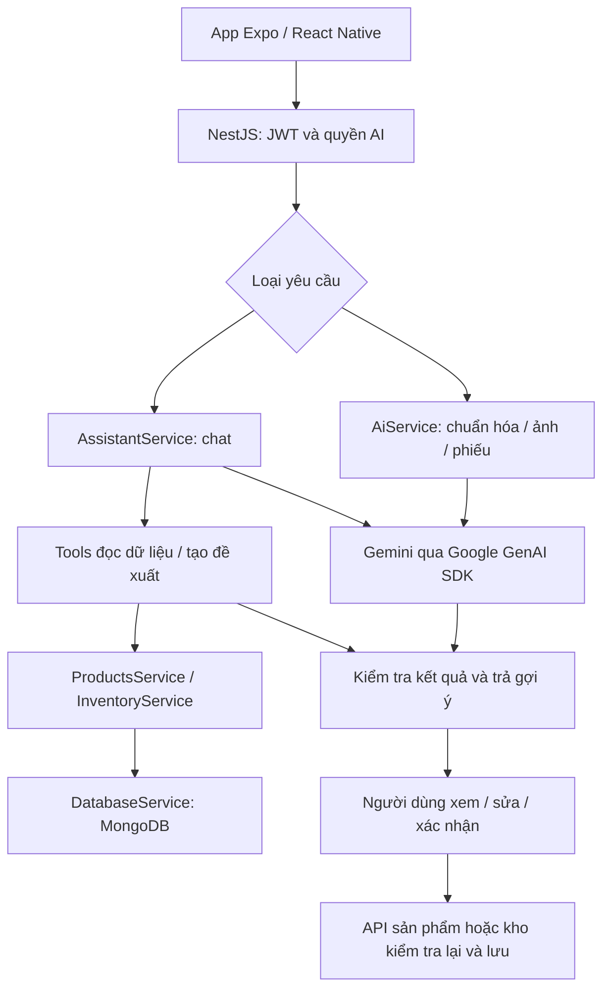
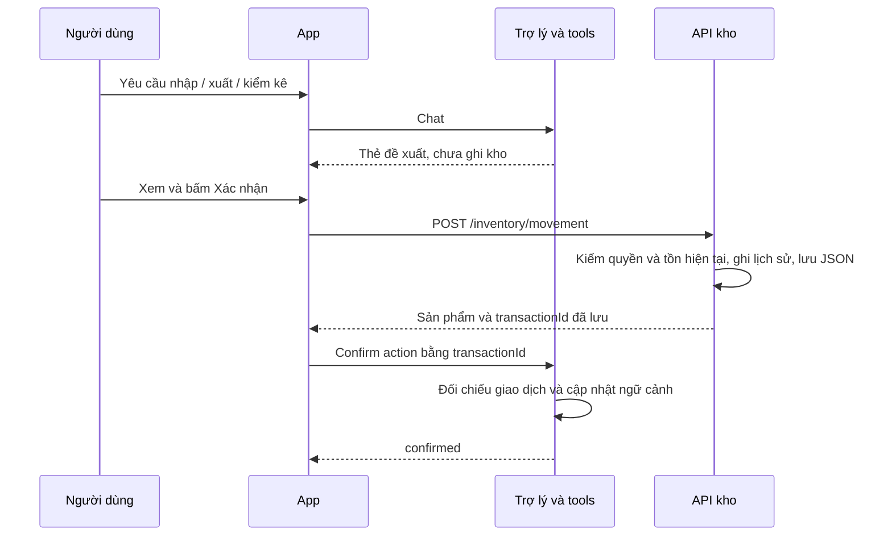

# Luồng xử lý AI – Inventory Support

Cập nhật 15/11/2026. Căn cứ nghiệp vụ: [NghiepVu.md](../NghiepVu.md), đặc biệt mục 2, 3.2–3.5 và 5. Tài liệu đối chiếu mã hiện tại, không xác nhận chất lượng Gemini trên dữ liệu thật. Backend đã đổi mã sang MongoDB; còn chờ cài package và nghiệm thu Atlas thật.

## 1. Mục tiêu và giới hạn nghiệp vụ

AI hỗ trợ người dùng tra kho và giảm nhập liệu, thông qua bốn nhánh: chuẩn hóa chữ, nhận diện ảnh sản phẩm, đọc phiếu nhập và hỏi đáp có công cụ. Backend là nguồn dữ liệu nghiệp vụ; model không tự quyết định tồn, cửa hàng hoặc quyền.

- Sản phẩm mới có tồn 0; tạo sản phẩm và nhập tồn là hai thao tác riêng.
- Danh mục/nhà cung cấp là chuỗi, không tự tạo collection hoặc nghiệp vụ quản lý riêng.
- Barcode là mã tra hàng; không thêm trường SKU riêng. Tên gần giống là ứng viên cần đối chiếu, không chứng minh hai mặt hàng là một.
- Kiểm kê là `ADJUSTMENT` trực tiếp theo quyền, chưa có phân công, gửi duyệt hoặc phê duyệt phiên.
- Không dùng AI để thay đổi tài khoản/quyền, xóa hàng, tự quy đổi đơn vị, dự báo hay xử lý kế toán. Bộ công cụ chat hiện chỉ đọc và tạo đề xuất.

## 2. Phân quyền áp dụng cho AI

| Chức năng | ADMIN | MANAGER | STAFF | VIEWER |
| --- | --- | --- | --- | --- |
| Chuẩn hóa chữ, nhận diện ảnh, chat (`AI_USE`) | Có | Có | Có | Không |
| Đề xuất mở form tạo sản phẩm (`PRODUCT_CREATE`) | Có | Có | Không | Không |
| Đề xuất nhập (`STOCK_IMPORT`) | Có | Có | Không | Không |
| Đề xuất xuất (`STOCK_EXPORT`) | Có | Có | Có | Không |
| Đề xuất kiểm kê (`STOCK_ADJUST`) | Có | Có | Không | Không |
| Đọc phiếu nhập (`AI_USE` + `STOCK_IMPORT`) | Có | Có | Không | Không |
| Công cụ tổng hợp (`REPORT_VIEW`, sau kiểm tra `AI_USE`) | Có | Có | Không | Không |

VIEWER có quyền xem báo cáo thường nhưng không có `AI_USE`, nên không dùng chat để xem báo cáo. STAFF có thể tra hàng sắp hết qua công cụ đọc kho nhưng không nhận danh sách thông báo cảnh báo như ADMIN/MANAGER.

JWT guard xác định người dùng; controller kiểm tra quyền AI; bộ tools lọc theo quyền và kiểm tra lại khi thực thi; API nghiệp vụ kiểm quyền một lần nữa khi lưu. `storeId` lấy từ người đăng nhập, không nhận lựa chọn cửa hàng từ model.

Giá nhập trong kết quả đối chiếu AI/thẻ sản phẩm được lọc theo `REPORT_VIEW` hoặc `PRODUCT_CREATE`. Đây không phải cam kết che giá nhập ở tất cả API: như NghiepVu.md đã ghi, `/inventory/summary` hiện yêu cầu `PRODUCT_VIEW`, cần rà soát riêng.

## 3. Kiến trúc và công nghệ

Provider hiện tại là Gemini qua `@google/genai`, cấu hình `GEMINI_API_KEY` và `AI_MODEL` ở backend. Mặc định model trong mã là `gemini-3.5-flash-lite`; khả năng dùng thực tế cần kiểm tra tài khoản. API key không đưa vào APK hoặc `EXPO_PUBLIC_*`.

Ảnh upload ở máy backend, theo `UPLOAD_DIR` (mặc định `uploads`); app giữ URL `/uploads/<storeId>/<file>`. Backend kiểm tra đường dẫn thuộc cửa hàng và đọc ảnh thành base64 khi gọi Gemini. Điện thoại cùng Wi-Fi gọi địa chỉ backend qua `EXPO_PUBLIC_API_URL`; gọi Gemini vẫn cần Internet.

Claude/offline còn file hoặc kiểu dữ liệu cũ trong repo, không phải luồng dự phòng đang chạy. Không áp dụng các cấu hình thinking/caching/beta hoặc chi phí Claude cũ cho luồng Gemini.

## 4. Luồng chat và quản lý phiên

### 4.1. Một lượt hỏi đáp

1. App gửi `POST /ai/assistant/chat` với `message` và `sessionId` nếu có. Backend kiểm tra quyền, nội dung không rỗng và tối đa 1.000 ký tự, cấu hình provider và tần suất.
2. Tạo phiên mới hoặc lấy phiên đúng người dùng, cửa hàng, vai trò và model. Prompt và bộ tools được ghim khi tạo phiên.
3. Khóa phiên đang xử lý, lưu mốc lịch sử trước lượt mới rồi gửi nội dung đến Gemini.
4. Khi model yêu cầu gọi hàm, backend kiểm tra tool, quyền và tham số; lấy dữ liệu từ service hoặc tạo thẻ đề xuất trong ngữ cảnh lượt. Kết quả trả về model dưới dạng function response.
5. Lặp tối đa 6 vòng. Nếu không hoàn tất thì báo lỗi yêu cầu chia nhỏ, không khẳng định đã có câu trả lời đầy đủ.
6. Khi hoàn tất, trả `provider: "gemini"`, `reply`, `products`, `actions`, `toolCalls`, `turn`, `maxTurns` và `sessionId`. Chỉ ghi nhận action của lượt thành công vào phiên.
7. Khi lỗi, bỏ phần hội thoại chưa hoàn tất về mốc trước lượt, giữ các lượt thành công và giải phóng khóa phiên.

Model phải tra công cụ trước khi trả lời tồn/giao dịch/số liệu; nhiều sản phẩm khớp thì hỏi người dùng chọn; dữ liệu tên/mô tả/ghi chú từ tools được xem là dữ liệu, không phải chỉ thị. Prompt là hướng dẫn model, không thay thế kiểm quyền và validation bằng mã.

### 4.2. Giới hạn phiên

| Giới hạn | Hiện tại |
| --- | --- |
| Lưu trữ | RAM, không nằm trong JSON; restart có thể mất phiên |
| Hết hạn | 2 giờ không hoạt động |
| Số lượt | 30 lượt thành công/phiên |
| Số phiên | Tối đa 5/người dùng; loại phiên cũ nhất |
| Đồng thời | Một yêu cầu/phiên, xung đột trả 409 |
| Tần suất chat | Mặc định 20 yêu cầu/5 phút/người, đổi bằng `AI_RATE_LIMIT` |
| Timeout | SDK 30 giây/lần; deadline chat tổng 60 giây |

Hết phiên, đổi role/model hoặc phiên không thuộc người dùng trả 404. Mobile quản lý việc bắt đầu lại qua store; không tự gửi lại giao dịch kho chỉ vì lỗi phiên. Reset phải bỏ response chat cũ để không hồi sinh phiên đã xóa. Không suy ra rate limit chat được áp dụng cho mọi endpoint ảnh/chuẩn hóa.

## 5. Luồng theo từng nghiệp vụ

### 5.1. Chuẩn hóa tên sản phẩm

1. Người có `AI_USE` nhập tên/mô tả tại `NormalizePanel` hoặc form có tích hợp chuẩn hóa.
2. App gọi `POST /ai/normalize-product`; backend lấy danh mục cửa hàng làm ngữ cảnh và gọi Gemini trích dữ liệu theo schema.
3. Kết quả tách từng món, sửa chính tả, gợi ý tên chuẩn, mô tả, danh mục và đơn vị. Tối đa 5 món; vượt giới hạn yêu cầu chia nhỏ, không âm thầm bỏ món thứ sáu.
4. Backend kiểm tra kết quả và đối chiếu từng gợi ý với sản phẩm trong đúng cửa hàng; trả `matchedProducts` đã lọc dữ liệu theo quyền.
5. Người dùng sửa và áp dụng từng thẻ; ứng viên tên gần giống cần xác nhận. Nếu tạo mới thì cần `PRODUCT_CREATE`, mở form và lưu qua API sản phẩm; việc gọi chuẩn hóa tự nó không tạo hàng.

Không suy đoán giá, barcode hoặc quy cách còn thiếu. Confidence là tự đánh giá của model, không phải bằng chứng đúng. Không tự đổi đơn vị của sản phẩm đã có khi áp dụng gợi ý.

### 5.2. Nhận diện ảnh sản phẩm

1. Người dùng chụp/chọn ảnh → `POST /uploads/image` → nhận URL ảnh thuộc cửa hàng.
2. App gửi URL và ghi chú tùy chọn đến `POST /ai/scan-image`.
3. Backend kiểm tra quyền/đường dẫn, đọc ảnh rồi gọi Gemini; kiểm tra cấu trúc kết quả và đối chiếu barcode/tên/quy cách với hàng hiện có.
4. App hiển thị gợi ý và ứng viên để người dùng chọn. Dùng sản phẩm sẵn có hoặc mở form tạo mới nếu đủ quyền; chưa có thao tác thay đổi tồn tại bước nhận diện.

Quét barcode/QR thông thường là tra mã qua backend, không cần Gemini. Ảnh mờ hoặc không đủ thông tin phải được kiểm tra lại bằng chụp lại/nhập tay.

### 5.3. Đọc phiếu nhập

1. ADMIN/MANAGER upload ảnh và gọi `POST /ai/scan-invoice`, cần cả quyền AI và nhập kho.
2. Gemini trích các dòng hàng; backend đối chiếu để trả danh sách `candidates` theo cửa hàng. App có thể chọn sẵn ứng viên đầu, nhưng người dùng vẫn phải kiểm tra từng dòng.
3. Người dùng đối chiếu sản phẩm, đơn vị tồn và số lượng với phiếu; không tự quy đổi “thùng” thành “chai”. Dòng chưa rõ phải sửa trước khi nhập.
4. Khi xác nhận, app gọi `POST /inventory/batch` với `type: IMPORT`; backend kiểm tra lại tất cả dòng, quyền và sản phẩm. Tối đa 200 dòng, không trùng sản phẩm.
5. API kho cập nhật tồn, ghi lịch sử và cảnh báo theo nghiệp vụ rồi commit MongoDB. AI đọc phiếu không tự cập nhật giá sản phẩm hoặc tạo giao dịch.

Batch đã chuyển mã sang MongoDB transaction; kiểm chứng đồng thời và rollback trên replica set thật còn chờ môi trường.

### 5.4. Chat tra cứu và thống kê

| Tool | Phạm vi | Quyền tool |
| --- | --- | --- |
| `search_products` | Tra tên, danh mục, tồn và barcode | `PRODUCT_VIEW` |
| `get_product` | Chi tiết sản phẩm và 5 giao dịch gần nhất | `PRODUCT_VIEW` |
| `list_low_stock` | Hàng thấp hơn hoặc bằng ngưỡng | `PRODUCT_VIEW` |
| `list_transactions` | Lịch sử theo sản phẩm/loại/khoảng ngày | `PRODUCT_VIEW` |
| `get_inventory_summary` | Tổng hợp tồn, nhập/xuất, giá trị và top xuất | `REPORT_VIEW` |
| `propose_stock_movement` | Tạo thẻ nhập/xuất/kiểm kê, chưa ghi | Quyền kho tương ứng `type` |
| `propose_new_product` | Tạo thẻ mở form thêm hàng, chưa ghi | `PRODUCT_CREATE` |

Không có tool cập nhật quyền hoặc xóa sản phẩm. Báo cáo doanh thu hiện lấy lượng xuất nhân giá bán hiện tại; câu trả lời phải được hiểu là ước tính theo cách tính của service, không phải sổ kế toán hoặc doanh thu snapshot.

### 5.5. Chat đề xuất thao tác kho và xác nhận

- `IMPORT`/`EXPORT`: quantity nguyên dương. `EXPORT` không vượt tồn; kiểm tra lại ở API kho vì tồn trên thẻ có thể đã cũ.
- `ADJUSTMENT`: quantity là số thực đếm nguyên không âm, bắt buộc lý do. Ví dụ tồn 120, đếm 113: đề xuất quantity 113; lịch sử ghi chênh lệch -7. Không yêu cầu phiên phê duyệt riêng.
- Tool tạo thẻ và kiểm tra quyền theo loại; người dùng có thể sửa qua màn nghiệp vụ hoặc bỏ qua. Bỏ qua không ghi kho.
- Sau lưu, app gọi `POST /ai/assistant/sessions/:id/actions/:actionId/confirm`. Backend kiểm tra action thuộc phiên, giao dịch cùng cửa hàng/người thao tác/sản phẩm/loại/số lượng và thời gian phù hợp.
- Confirm chỉ đồng bộ ngữ cảnh, không gọi model, không tăng lượt chat và không ghi kho. Gửi lại cùng bằng chứng được chấp nhận; không phải cơ chế idempotency của `/inventory/movement`.
- Nếu đồng bộ trợ lý thất bại sau lưu, thông báo “giao dịch đã lưu” và hướng dẫn hỏi lại số tồn; không tự gửi lại nhập/xuất. Khóa nút trong app không bảo đảm chống lặp ở mọi tình huống mất mạng.

### 5.6. Chat đề xuất tạo sản phẩm

Tra trước khi đề xuất. Barcode đã có cần dùng sản phẩm sẵn có; tên gần giống hiện cảnh báo để đối chiếu. `CREATE_PRODUCT` mở `ProductFormScreen` với dữ liệu điền sẵn, người dùng xem rồi gọi `POST /products`. Mở form không đồng nghĩa đã tạo. Sản phẩm lưu thành công có tồn 0 và cần nhập riêng nếu muốn tăng tồn.

## 6. Lỗi và thao tác tiếp theo

Thiếu `GEMINI_API_KEY` hoặc provider lỗi: trả lỗi và giữ khả năng thao tác thủ công; không tự chuyển Claude/offline hoặc trả dữ liệu heuristic như kết quả Gemini. `/ai/status` chỉ phản ánh cấu hình, không xác nhận key/model/quota thực sự sử dụng được.

App giữ dữ liệu nhập và ảnh để sửa/thử lại; không áp dụng response cũ khi người dùng đã đổi input/reset. Hết quota hoặc giới hạn tần suất cần thông báo đúng loại khi có căn cứ; không coi mọi 429 là hết quota ngày. Timeout, JSON không hợp lệ, kết quả bị chặn hoặc chưa hoàn tất phải báo lỗi, không áp dụng dữ liệu dở.

Lỗi API nghiệp vụ xử lý theo kết quả thực tế. Nếu không biết chắc giao dịch đã lưu sau mất kết nối, kiểm tra lịch sử/tồn trước khi thao tác lại; hệ thống hiện chưa bảo đảm chống ghi lặp toàn cục.

## 7. File phụ trách

| File/thư mục | Trách nhiệm |
| --- | --- |
| `Server/backend/src/ai/ai.controller.ts` | Endpoint AI, quyền và đối chiếu sản phẩm |
| `src/ai/ai.service.ts`, `gemini-product-vision.ts`, `gemini-errors.ts` trong backend | Chuẩn hóa/vision, validation kết quả và ánh xạ lỗi Gemini |
| `src/ai/assistant/assistant.service.ts` | Prompt, vòng gọi hàm và xác nhận giao dịch |
| `src/ai/assistant/assistant-tools.ts` | Tools, kiểm quyền, trình bày dữ liệu và tạo đề xuất |
| `src/ai/assistant/assistant-session.store.ts` | Phiên RAM, khóa, TTL và rate limit |
| `src/products/`, `src/inventory/`, `src/notifications/`, `src/database/` trong backend | Nghiệp vụ thật và lưu trữ |
| `App/InventorySupport/src/screens/ai/` | Chat, chuẩn hóa và ActionCard |
| `App/InventorySupport/src/screens/scanner/` | Quét mã/ảnh/phiếu và bước người dùng duyệt |
| `App/InventorySupport/src/components/AiSuggestionCard.tsx` | Hiển thị/sửa gợi ý |
| `App/InventorySupport/src/store/assistant.store.tsx` | Trạng thái hội thoại, reset và đồng bộ confirm |
| `App/InventorySupport/src/services/ai.service.ts` | Gọi API AI |

## 8. Tiêu chí kiểm chứng theo nghiệp vụ

- STAFF không được đề xuất/lưu IMPORT hoặc ADJUSTMENT; VIEWER không gọi AI; ADMIN/MANAGER dùng theo quyền.
- Tra cứu không trả sản phẩm/giao dịch khác cửa hàng; dữ liệu giá nhập trong kết quả AI được lọc theo quyền.
- Chuẩn hóa nhiều món không tự lưu, không mất món vượt giới hạn, không bịa giá/barcode và không đổi đơn vị hàng cũ.
- Phiếu nhập phải duyệt, không tự đổi đơn vị, không ghi trước xác nhận; batch lỗi không áp dụng một phần do validation.
- Kiểm kê 0 hợp lệ khi có lý do; thiếu lý do bị chặn; số thực đếm và chênh lệch lịch sử đúng.
- Thẻ kho tạo ra không thay đổi dữ liệu; xác nhận kiểm tồn lại; confirm lỗi sau lưu không ghi giao dịch lần hai.
- Tạo sản phẩm qua thẻ cần mở form và lưu, tồn ban đầu bằng 0.
- Lỗi Gemini không gây logout do nhầm lỗi provider với JWT, không giữ kết quả cũ như kết quả mới, không làm kẹt phiên.
- Báo cáo phản ánh đúng công thức hiện tại, không tuyên bố giá lịch sử hoặc nghiệp vụ kế toán chưa có.

Kiểm thử dùng mock để tiết kiệm quota; ảnh/phiếu thật và APK cần nghiệm thu riêng. Lần cập nhật tài liệu này chưa chạy lại test hay gọi model thật. Tham khảo [báo cáo Gemini](AI_GEMINI_MIGRATION_REPORT.md), [luồng quét](SCAN.md) và [bộ ca chuẩn hóa](AI_NORMALIZATION_EVAL.md); các mô tả provider/fallback cũ trong tài liệu liên quan cần đối chiếu với mã hiện tại.
