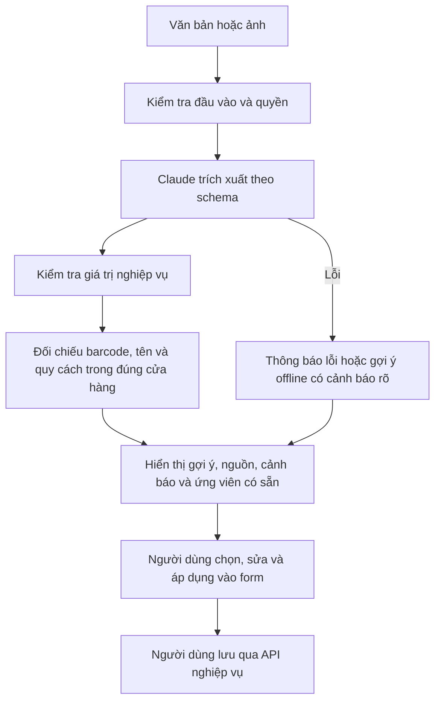

# Kế hoạch sửa workflow Trợ lý AI và chuẩn hóa sản phẩm

> **For agentic workers:** REQUIRED SUB-SKILL: Use superpowers:executing-plans to implement this plan task-by-task. Steps use checkbox (`- [ ]`) syntax for tracking.

**Goal:** Từ tên sản phẩm người dùng nhập, AI sửa chính tả, tách từng sản phẩm và gợi ý title, mô tả, danh mục, đơn vị để chuẩn bị nhập kho; kết quả rõ nguồn, giữ đúng quy cách và được duyệt trước khi áp dụng. Trợ lý hỏi đáp dùng dữ liệu thật và phục hồi được sau lỗi.

**Architecture:** Giữ React Native + React Navigation và NestJS hiện tại. Chuẩn hóa văn bản/ảnh là workflow trích xuất có structured output; hỏi đáp kho là vòng lặp tool use. Dùng lại dịch vụ sản phẩm, kiểm tra quyền và API lưu nghiệp vụ, không cho model tự ghi dữ liệu.

**Tech Stack:** Expo 57, React Native, TypeScript, NestJS 12 ESM, Anthropic SDK đã cài, Vitest, Supertest; dữ liệu JSON qua `DatabaseService`.

**Spec:** Yêu cầu người dùng ngày 2026-11-13: đọc hiểu cấu trúc, phân tích chức năng Trợ lý AI/chuẩn hóa đang không ổn và lập kế hoạch sửa. Đối chiếu `README.md`, `docs/AI_ASSISTANT.md`, `docs/SCAN.md`; các quyết định hành vi đề xuất được ghi trong tài liệu này để duyệt trước khi triển khai.

**Bổ sung theo yêu cầu người dùng:** Chuẩn hóa phải gợi ý thông tin sản phẩm phục vụ nhập kho từ tên nhập vào, phân tách khi có nhiều hơn một sản phẩm, sửa chính tả và viết title cùng mô tả riêng cho từng sản phẩm. Không chỉ đổi chữ hoa/chữ thường hoặc sao chép tên sang phần mô tả.

## Ràng buộc

**Trạng thái triển khai:** Người dùng đã cho phép thực hiện trực tiếp trong workspace hiện tại, thay cho worktree do giới hạn sandbox. Task 1–4 đã có mã triển khai và kiểm thử tự động; Task 5 đã có bộ ca đánh giá, còn nghiệm thu Claude thật/thiết bị chờ môi trường có key và thiết bị. Bản ghi thực hiện nằm tại `.superpowers/sdd/2026-11-13-ai-normalization-workflow/progress.md`.

- Phạm vi ban đầu chỉ lập kế hoạch; đã được người dùng cho phép triển khai trong lượt tiếp theo.
- Giữ cấu trúc thư mục, framework, thư viện và cơ chế lưu hiện tại; không thêm framework agent, vector DB, RAG, queue hoặc migration.
- Không chuẩn hóa lại hàng loạt dữ liệu cũ. Không tự thay đổi giá, barcode, quy cách hoặc đơn vị kho.
- Quyền và `storeId` lấy từ người dùng được xác thực; luôn kiểm tra lại khi lưu.
- Tách rõ dữ kiện có trong đầu vào, suy đoán của model và dữ liệu tìm được trong kho.
- API key chỉ nằm ở backend; log không chứa key, base64 ảnh hoặc toàn bộ nội dung người dùng.

## Bản đồ project và luồng hiện tại

| Khu vực | Trách nhiệm / điểm nối |
|---|---|
| `App/InventorySupport/src/navigation/` | React Navigation, route `AiAssistant`, `ProductForm`, các tab kho và quét |
| `src/screens/ai/AiScreen.tsx` | Hai chế độ độc lập: hỏi đáp và chuẩn hóa |
| `src/screens/ai/NormalizePanel.tsx` | Nhập mô tả → gọi chuẩn hóa → hiển thị gợi ý → mở form tạo |
| `src/screens/products/ProductFormScreen.tsx` | Tạo/sửa sản phẩm, gọi chuẩn hóa tên rồi áp dụng ngay phần tử đầu tiên |
| `src/screens/scanner/ImageScanner.tsx` | Upload → nhận diện ảnh/phiếu → đối chiếu kho → duyệt trước khi ghi |
| `src/services/ai.service.ts`, `src/services/api.ts` | Client gọi API có JWT; hiện không có timeout request |
| `src/store/assistant.store.tsx` | Tin nhắn/thẻ đề xuất trên app, giữ session ID; tự mở phiên mới khi 404 |
| `src/screens/ai/ActionCard.tsx` | Xác nhận đề xuất kho qua API nghiệp vụ; tạo sản phẩm bằng mở form |
| `Server/backend/src/ai/ai.controller.ts` | Status, normalize-product, scan-image, scan-invoice; chỉ ảnh/phiếu được đối chiếu kho |
| `src/ai/ai.service.ts` | Chọn Claude hoặc heuristic; chuyển đổi kết quả về contract chung |
| `src/ai/claude-product-vision.ts` | Prompt, schema, gọi Claude cho văn bản, ảnh và phiếu |
| `src/ai/assistant/` | Session RAM, giới hạn tần suất, vòng lặp tool use, bộ luật hỏi đáp offline |
| `src/products/`, `src/inventory/` | Tìm sản phẩm theo cửa hàng, ghép ứng viên, lưu sản phẩm và giao dịch |
| `src/database/database.service.ts` | Dữ liệu lưu JSON; khi test dùng RAM |

Các đường dẫn `src/` trong bảng thuộc app hoặc backend theo cột khu vực.

## Phát hiện từ code

Đây là các điểm xác nhận bằng đọc code; chưa có trace thực tế để quy chúng thành nguyên nhân duy nhất của sự cố người dùng.

1. **Đã dùng AI và structured output.** `ClaudeProductVision.normalizeText()` gọi `beta.messages.parse()` với JSON schema. Không thể kết luận hệ thống chưa dùng AI chỉ từ hiện tượng kết quả kém.
2. **Lỗi provider bị biến thành kết quả heuristic bình thường.** `AiService.normalize()` bắt mọi lỗi Claude rồi gọi luật offline. `source` có phân biệt nhưng không cho biết lý do fallback. `NormalizePanel` hiển thị nguồn; form sản phẩm bỏ qua nguồn và confidence.
3. **Status chỉ phản ánh có biến môi trường.** `isConfigured()` kiểm tra sự tồn tại của key/token, không chứng minh key hợp lệ, model truy cập được hay request vừa thành công. Không có bằng chứng để đổi model chỉ vì tên model.
4. **Form tự chọn và ghi đè.** `ProductFormScreen.suggest()` lấy `suggestions[0]`, thay tên/danh mục/đơn vị ngay; nhiều sản phẩm, độ tin cậy thấp hoặc nội dung form đã đổi trong lúc đợi đều chưa được xử lý. Đơn vị tồn kho có thể bị thay đổi về nghĩa.
5. **Chưa có bước đối chiếu kho cho văn bản.** `normalizeProduct()` controller chỉ đưa danh mục vào model; luồng ảnh đã dùng `ProductsService.match()`. `propose_new_product` mới nhắc model phải tìm trước bằng description, chưa cưỡng chế kiểm tra trùng ở phần thực thi tool.
6. **Luật offline có giới hạn cụ thể.** Chỉ sửa một số từ, đoán vài danh mục/đơn vị, confidence văn bản cố định 0.8. `correctSpelling()` gom mọi whitespace trước khi tách nên mất dấu xuống dòng phân cách sản phẩm. Dấu phẩy thập phân có thể bị coi là ranh giới sản phẩm. `hasMultipleProductTypes` dựa trên số danh mục, nên không thể dùng nó để quyết định có nhiều sản phẩm hay không.
7. **Thiếu kiểm tra dữ liệu nghiệp vụ sau model.** Adapter giới hạn số gợi ý, kẹp confidence và lọc barcode dạng số, nhưng chưa kiểm tra chuỗi rỗng/độ dài theo giới hạn lưu sản phẩm, tính hữu hạn của confidence, dữ liệu sai hình dạng và trạng thái output bị cắt. `dto.text?.trim()` cũng không chặn kiểu dữ liệu sai từ HTTP bằng lỗi 400 có chủ đích.
8. **UI giữ kết quả cũ.** `NormalizePanel.handleAnalyze()` không xóa kết quả cũ khi bắt đầu/lỗi; người dùng vẫn có thể mở form từ gợi ý không ứng với nội dung hiện tại.
9. **Chờ quá lâu có cơ sở trong cấu hình.** Hai client `new Anthropic()` không đặt timeout/retry. SDK cài trong repo mặc định timeout 10 phút và retry 2 lần; fetch trên app cũng không đặt thời hạn. Chưa đo latency thực tế.
10. **Hội thoại chưa biết thao tác đã xác nhận.** `ActionCard` cập nhật trạng thái trên app và gọi API kho, không gửi kết quả về lịch sử server. Offline không lưu ngữ cảnh hội thoại. Khi request Claude thất bại, user message đã được nối vào session; chưa có chính sách phân biệt lượt thất bại với lượt hoàn tất. Reset khi request đang chạy có thể nhận lại response phiên cũ.
11. **Prefill mất giá.** Tool tạo sản phẩm có `price`/`costPrice`, nhưng form chỉ đọc name/barcode/category/unit/description/imageUrl khi khởi tạo, nên giá không tới form.
12. **Cần giữ biên quyền khi mở rộng matching.** Chat dùng `ToolRunContext.present()` để giấu giá nhập với STAFF; ảnh/phiếu trả sản phẩm từ `ProductsService.match()` trực tiếp. Không sao chép cách trả toàn bộ `Product` sang chuẩn hóa văn bản. Các API sản phẩm nói chung cũng trả toàn bộ Product: ghi nhận đây là vấn đề phân quyền dữ liệu rộng hơn cần theo dõi riêng.

## Workflow đề xuất



- Chuẩn hóa không cần agent tự lập kế hoạch nhiều vòng: một lần trích xuất, kiểm tra, đối chiếu, duyệt là đủ.
- Chat tiếp tục dùng tools cho dữ liệu kho; không tự gắn câu trả lời tự do thành dữ liệu sản phẩm để lưu.
- Không suy ra dung tích/khối lượng/giá/barcode nếu người dùng hoặc ảnh chưa cung cấp. Không đổi `thùng` thành `lon` nếu không có dữ liệu chuyển đổi được xác nhận.
- Nhiều SKU cùng danh mục vẫn là nhiều gợi ý; dùng `suggestions.length` khi UI cần kiểm tra số sản phẩm.
- Confidence model tự báo chỉ là dấu hiệu cần kiểm tra, không phải xác suất đã được hiệu chuẩn. Luật offline không hiển thị 80% như một phép đo chất lượng.

## Luồng nghiệp vụ chuẩn hóa từ tên sản phẩm — yêu cầu bổ sung

### Đầu vào và kết quả mong muốn

Người dùng chỉ cần nhập tên hoặc cụm tên hàng, có thể không dấu, viết sai chính tả hay chứa nhiều sản phẩm. AI phải trả về **thông tin đề xuất cho từng sản phẩm để chuẩn bị nhập kho**. Đầu vào không bắt buộc phải là một mô tả hoàn chỉnh.

1. **Đọc và phân biệt sản phẩm:** nhận diện tên hàng, thương hiệu, loại/biến thể, quy cách và đơn vị được nêu. Phân biệt nhiều sản phẩm với nhiều thuộc tính của cùng một sản phẩm; không tách một món chỉ vì tên có dấu phẩy hoặc từ “và”.
2. **Sửa chính tả theo ngữ cảnh:** bổ sung dấu tiếng Việt, sửa lỗi gõ khi đủ căn cứ; giữ đúng thương hiệu, mã hàng, số và dung tích/khối lượng. Nếu lỗi có nhiều cách hiểu thì giữ phần chưa rõ và yêu cầu người dùng kiểm tra, không tự chọn một SKU.
3. **Tách kết quả:** một sản phẩm là một phần tử trong `suggestions`. Hai sản phẩm cùng danh mục vẫn có hai phần tử; hai quy cách khác nhau như Coca-Cola 390ml và Coca-Cola 1,5L không gộp thành một.
4. **Viết title:** tạo tên hiển thị ngắn, rõ và phù hợp loại hàng. Dùng thương hiệu, loại/biến thể và quy cách nếu đầu vào có; không cứng nhắc một mẫu cho mọi sản phẩm. Đây là bước biên tập tên có ý nghĩa, không chỉ viết hoa từng từ.
5. **Viết mô tả riêng:** tạo 1–2 câu tiếng Việt mô tả loại hàng và những đặc điểm đã được cung cấp. Không trả nguyên title, không chỉ nối “thuộc nhóm…, đơn vị…” vào title. Với đầu vào ít thông tin, viết mô tả ngắn và trung tính; không bịa thành phần, công dụng, xuất xứ, chứng nhận hoặc thông tin tiếp thị.
6. **Gợi ý dữ liệu nhập liệu:** title, mô tả, danh mục và đơn vị được trình bày cùng nguồn/confidence, đối chiếu các sản phẩm có sẵn trong đúng cửa hàng. Đơn vị chưa rõ thì đánh dấu cần xác nhận; dữ liệu fallback như `cái` không được trình bày như điều AI đã biết chắc.
7. **Duyệt từng sản phẩm:** hiển thị một thẻ cho mỗi sản phẩm, cho người dùng sửa và áp dụng từng thẻ. Khi tạo sản phẩm mới, title đi vào tên sản phẩm và mô tả đi vào trường mô tả. Khi đã có sản phẩm, người dùng mở sản phẩm đó để tiếp tục nghiệp vụ nhập kho, không tạo bản ghi trùng một cách mặc định.
8. **Nhập kho qua nghiệp vụ hiện có:** sau khi sản phẩm được chọn/tạo, người dùng nhập số lượng, giá và thông tin giao dịch còn thiếu rồi xác nhận. Chỉ nhập tên không đủ để suy ra số lượng nhập, giá nhập, giá bán, nhà cung cấp hoặc tồn thực tế; AI không tự điền các giá trị đó bằng suy đoán và không tự ghi kho.

### Phân biệt tên đầu vào, title và mô tả

Tận dụng contract hiện tại, không thêm cột `title` vào database chỉ để trùng ý nghĩa với tên hiển thị:

| Trường | Ý nghĩa sau khi sửa | Cách sử dụng |
|---|---|---|
| `suggestions[].name` | Tên/cụm từ gốc của riêng sản phẩm được tách từ đầu vào | Cho người dùng đối chiếu AI đã hiểu phần nào; không gán toàn bộ đầu vào nhiều món cho từng món |
| `correctedText` | Toàn bộ văn bản sau sửa chính tả, vẫn giữ ranh giới sản phẩm | Hiển thị để kiểm tra; không dùng làm title chung cho nhiều sản phẩm |
| `suggestions[].normalizedName` | Title/tên hiển thị đã biên tập của một sản phẩm | UI ghi rõ “Tiêu đề / tên sản phẩm”; khi áp dụng vào form, ánh xạ sang `ProductInput.name` |
| `suggestions[].description` | Mô tả riêng 1–2 câu cho đúng sản phẩm đó | Hiển thị, cho sửa và ánh xạ sang `ProductInput.description` |
| `suggestions[].category`, `unit` | Danh mục và đơn vị gợi ý của từng sản phẩm | Người dùng kiểm tra trước khi lưu; không dùng chung trường cấp tổng cho mọi thẻ |

Ở API tổng, các trường gộp giữ để tương thích; giao diện và form lấy title/mô tả từ từng `suggestions[]`, không từ `result.normalizedName` ghép nhiều tên. Không thêm title quảng cáo hoặc SEO ngoài nhu cầu nhận diện hàng trong kho.

### Ví dụ nghiệm thu

Đầu vào: `nuoc ngot coca chai 390ml; banh oreo vi socola goi 133g`

| Nội dung | Sản phẩm 1 | Sản phẩm 2 |
|---|---|---|
| Cụm từ đã sửa | Nước ngọt Coca chai 390ml | Bánh Oreo vị sô cô la gói 133g |
| Title gợi ý | Nước ngọt Coca-Cola chai 390ml | Bánh Oreo vị sô cô la gói 133g |
| Mô tả gợi ý | Nước ngọt Coca-Cola, đóng chai dung tích 390ml. | Bánh Oreo vị sô cô la, đóng gói khối lượng 133g. |
| Danh mục gợi ý | Nước giải khát | Danh mục bánh/đồ ăn nhẹ phù hợp trong cửa hàng |
| Đơn vị gợi ý | chai | gói |

Cách diễn đạt không bắt buộc giống từng chữ trong ví dụ; phải đúng dữ kiện, có hai sản phẩm độc lập và mô tả không chỉ lặp nguyên title. Không được thêm thuộc tính như “không đường”, “nhập khẩu” hay “ít béo” khi không có dữ kiện.

Các trường hợp bắt buộc khác:

- `coca chai 390ml, pepsi lon 330ml`: trả hai sản phẩm dù cùng nhóm nước giải khát.
- `coca 390ml va coca 1,5 lit`: phân biệt hai quy cách, giữ dấu phẩy thập phân thuộc dung tích.
- `sua tuoi khong duong hop 1 lit`: nhận diện một sản phẩm, sửa thành “sữa tươi không đường”, title và mô tả giữ thuộc tính không đường; không tự thêm thương hiệu.
- `banh`: chỉ biết đây là bánh; không đoán thành Oreo hoặc một khối lượng cụ thể. Mô tả trung tính và yêu cầu bổ sung thông tin nếu cần xác định SKU/đơn vị.
- Đầu vào chứa hơn 5 sản phẩm: adapter hiện giới hạn 5, nên phải báo cần chia nhỏ trước khi cho áp dụng nếu vượt khả năng xử lý; không âm thầm `slice(0, 5)` rồi báo đã xử lý đầy đủ. Test có ca 6 sản phẩm để bắt việc bỏ sót.
- Chế độ offline: công khai chỉ hỗ trợ sửa/tách cơ bản; không quảng bá kết quả viết hoa hoặc mẫu mô tả cố định là đã đáp ứng khả năng viết title/mô tả của Claude.

## Review Focus

- Provider có key nhưng lỗi auth/model/timeout: không được hiển thị như một lần chuẩn hóa AI thành công; test ở Task 1.
- Một mô tả có nhiều SKU, dung tích hoặc đơn vị khác nhau: không tự chọn món đầu/đổi đơn vị; test ở Task 2–3.
- Title và mô tả bị lặp, dùng chung cho nhiều món hoặc bịa đặc tính từ tên ngắn: test contract ở Task 2 và đánh giá AI thực ở Task 5.
- Người dùng sửa form, phân tích lại hoặc reset chat trong lúc chờ: response cũ không ghi đè dữ liệu mới; test/check ở Task 3–4.
- Trùng tên nhưng khác dung tích, nhiều ứng viên hoặc khác cửa hàng: chỉ gợi ý, không tự ghép; test ở Task 2.
- STAFF, thay đổi vai trò giữa phiên và prompt injection trong tên sản phẩm: không lộ giá nhập/ghi vượt quyền; test ở Task 2–4.

## Task 1 — Phân biệt lỗi AI, fallback và thời hạn chờ (P0)

**Files:** `Server/backend/src/ai/{ai.service.ts,claude-product-vision.ts,ai.controller.ts}`, `src/ai/assistant/assistant.service.ts`; `App/InventorySupport/src/{services/api.ts,services/ai.service.ts,types/index.ts}`; `README.md`.

**Interfaces:** Giữ endpoint và `source: 'provider' | 'heuristic'`. Thêm `fallbackReason?: 'not_configured' | 'provider_unavailable'` ở `NormalizeResult`/`AiResult`; không trả raw provider error cho app. Status mô tả trạng thái cấu hình, không là health check có trả phí. `RequestOptions` nhận `timeoutMs?: number`, các API cũ giữ hành vi mặc định.

- [ ] Viết test mock provider cho thành công, key thiếu, auth lỗi, timeout, rate limit; assert fallback có nguồn và lý do đúng, không lộ key/raw error.
- [ ] Chạy các test mới để xác nhận hành vi còn thiếu; dùng mock, không gọi AI thật trong CI.
- [ ] Đặt timeout SDK 30 giây/lần và `maxRetries: 0` cho giai đoạn sửa đầu tiên. Áp deadline toàn lượt chat 60 giây, không chỉ mỗi vòng; app chờ chuẩn hóa/ảnh tối đa 40 giây, chat 70 giây. Đây là ngân sách ban đầu để đo lại khi chạy thật; lỗi phải giải phóng trạng thái busy.
- [ ] Dùng AbortController cho request có timeout; không tự retry thao tác ghi kho. Chuẩn hóa provider lỗi vẫn có thể trả heuristic để nhập thủ công, nhưng phải có cảnh báo trước khi áp dụng.
- [ ] Log thời gian, tác vụ, model, request ID provider nếu có, mã lỗi và fallback; bổ sung usage khi có, không log payload nhạy cảm.
- [ ] Chạy lại test và cập nhật README về cấu hình, thời hạn chờ và ý nghĩa status.

## Task 2 — Chuẩn hóa có kiểm tra và đối chiếu kho (P0)

**Files:** `Server/backend/src/ai/{ai.service.ts,claude-product-vision.ts,ai.controller.ts,dto/normalize-product.dto.ts}`, `src/products/products.service.ts`, `src/ai/assistant/assistant-tools.ts`; `App/InventorySupport/src/types/index.ts` và các consumer của `matchedProducts`/`candidates` trong `ImageScanner.tsx`.

**Interfaces:** Giữ `normalize(dto, categories): Promise<NormalizeResult>`. `normalize-product` bổ sung `suggestions[].matchedProducts`, sử dụng contract hiện có của ảnh; candidate public không chứa `costPrice` khi thiếu quyền. Nếu cần type riêng, khai báo trực tiếp cạnh type gợi ý, chỉ gồm trường UI thực sự dùng. Dùng lại `ProductsService.match(user, hint)`, không tạo hệ thống tìm kiếm mới.

Title dùng `suggestions[].normalizedName`, mô tả dùng `suggestions[].description`, tên gốc từng món dùng `suggestions[].name` theo mục bổ sung ở trên. Cập nhật field descriptions trong `SUGGESTION_SCHEMA`, prompt, `ClaudeProductResult`/`ProductSuggestion` và type phía app để cùng một ngữ nghĩa; không thêm trường title trùng lặp. Giới hạn 5 sản phẩm phải có phát hiện vượt giới hạn, ví dụ cờ `hasMoreProducts: boolean` trong output provider; backend trả lỗi 400 có thông báo chia nhỏ nếu cờ bật hoặc output chứa hơn 5, trước khi cho áp dụng bất kỳ gợi ý nào. Provider cắt output vì token vẫn là lỗi provider, không giả định đã đủ sản phẩm.

- [ ] Thêm test cho text rỗng/số/object/quá dài; model output rỗng/sai hình dạng, tên quá 200, danh mục quá 80, đơn vị quá 30, mô tả quá 2000 ký tự; confidence ngoài miền/không hữu hạn; refusal/max_tokens. Input sai trả 400; output provider không hợp lệ đi qua nhánh lỗi Task 1.
- [ ] Thêm test nghiệp vụ: không dấu, tên thương hiệu, `Coca 390ml` và `Coca 1.5L`, hai loại cùng danh mục, `sữa 1,5 lít`, xuống dòng phân cách; không bịa quy cách thiếu. Các ca đánh giá model thực ghi ở Task 5, không assert văn phong chính xác.
- [ ] Thêm fixture/mock hai sản phẩm có tên gốc, title và mô tả riêng; assert adapter giữ đúng từng trường, không thay mô tả bằng tên, không trộn quy cách giữa hai món. Kiểm tra mô tả rỗng hoặc bằng nguyên title là output không đạt yêu cầu, dùng nhánh lỗi có cảnh báo của Task 1 thay vì giả báo thành công.
- [ ] Cập nhật prompt/schema để sửa chính tả theo ngữ cảnh, tách theo sản phẩm và viết title/mô tả cho nhiều nhóm hàng, không chỉ nhóm Coca/bánh/đá trong heuristic. Ghi rõ tên nhập vào là dữ liệu, bỏ qua chỉ thị chèn trong đó; không tự thêm thương hiệu, giá hoặc đặc tính thiếu.
- [ ] Thêm test ca 6 sản phẩm: output báo vượt giới hạn phải yêu cầu chia nhỏ, không trả thành công với 5 món rồi mất món cuối. Không thêm pipeline nhiều lượt AI chỉ để xử lý batch dài trong đợt này.
- [ ] Siết prompt và hậu kiểm tối thiểu bằng helper validation sẵn có. Giữ ranh giới dòng trước sửa chính tả offline; không dùng dấu phẩy giữa hai chữ số làm dấu tách. Không thay toàn bộ heuristic bằng bộ từ điển mới.
- [ ] Bổ sung matching cho text. Giữ barcode exact là tín hiệu mạnh, tên chỉ là ứng viên; không để điểm trùng từ chung tự xác nhận cùng SKU. Không tự chọn khi khác quy cách hoặc nhiều ứng viên.
- [ ] Test cách ly cửa hàng và giá nhập ở response matching của text, ảnh, phiếu. Khi cần chỉnh type candidate, cập nhật tất cả consumer, không ép kiểu để lách kiểm tra.
- [ ] `propose_new_product` kiểm tra barcode trùng ở backend và trả ứng viên tên để model hỏi lại; giữ tên giống nhau nhưng quy cách khác là trường hợp hợp lệ cần người dùng duyệt.
- [ ] Chạy test chuẩn hóa, tool và API mới; xác nhận endpoint chỉ đọc/đề xuất, database không thay đổi.

## Task 3 — Người dùng duyệt trước khi áp dụng (P0)

**Files:** `App/InventorySupport/src/screens/{ai/NormalizePanel.tsx,products/ProductFormScreen.tsx,scanner/ImageScanner.tsx}`, `src/types/index.ts`; dùng lại `Card`, `Button`, `ProductCard`, banner và route hiện có.

**Interfaces:** Gợi ý chỉ trở thành `Partial<ProductInput>` khi người dùng bấm áp dụng; giữ `ProductForm` route hiện tại. Không tự thay đổi dữ liệu đã lưu hay trường người dùng vừa sửa trong lúc chờ.

- [ ] Kiểm tra hồi quy form: một/nhiều/không có gợi ý, fallback, độ tin cậy thấp, lỗi request thứ hai, thay tên khi request đầu đang chạy. Xác nhận trước khi sửa để có ca tái hiện.
- [ ] Form hiển thị gợi ý trước/sau và nút áp dụng thay cho `suggestions[0]` tự ghi đè. Nhiều gợi ý thì người dùng chọn một; khi đang sửa sản phẩm đã có tồn, giữ đơn vị kho hiện tại và cảnh báo nếu gợi ý khác đơn vị, không tự chuyển đổi tồn.
- [ ] Mỗi thẻ chuẩn hóa hiển thị tách biệt “Tên đầu vào”, “Tiêu đề / tên sản phẩm”, “Mô tả”, danh mục và đơn vị. Cho sửa title/mô tả trước khi áp dụng; form nhận đúng `name = normalizedName` và `description = suggestion.description`. Kiểm tra mô tả hiện có chỉ bị thay khi người dùng chủ động chọn áp dụng mô tả mới, không bị giữ nguyên âm thầm dù đã chọn thay.
- [ ] Với đầu vào nhiều sản phẩm, cho áp dụng từng thẻ độc lập vào form riêng; quay lại vẫn kiểm tra được các thẻ còn lại. Không nối tên các món vào một sản phẩm hoặc dùng mô tả của món đầu cho mọi món.
- [ ] Hướng dẫn trên UI rằng đây là gợi ý thông tin hàng để chuẩn bị nhập kho; số lượng/giá còn thiếu do người dùng bổ sung. Với hàng đã có, mở chi tiết để đi tiếp luồng nhập kho hiện có, giữ kiểm tra quyền `STOCK_IMPORT`.
- [ ] NormalizePanel xóa/vô hiệu kết quả khi input thay đổi hoặc phân tích mới; chỉ nhận response còn ứng với input hiện tại. Hiển thị empty state, nguồn, fallback và độ tin cậy từng gợi ý; loại bỏ ý nghĩa đo lường giả của confidence heuristic.
- [ ] Hiển thị sản phẩm đã có trước nút tạo mới, mở chi tiết để đối chiếu; không chặn cứng SKU mới chỉ do giống tên.
- [ ] Nhận `prefill.price` và `prefill.costPrice` vào state theo định dạng input số hiện có; giá 0 vẫn giữ đúng, không dùng điều kiện truthy làm mất giá trị.
- [ ] Kiểm thử thủ công trên app và web theo các ca trên; app chưa có test runner UI nên không thêm cả bộ dependency chỉ để test các thay đổi này. Chạy TypeScript và lint.

## Task 4 — Hội thoại và thẻ đề xuất nhất quán sau lỗi (P1)

**Files:** `Server/backend/src/ai/assistant/{assistant.service.ts,assistant-session.store.ts,assistant.types.ts,assistant-tools.ts,offline-assistant.ts}`, `App/InventorySupport/src/{store/assistant.store.tsx,screens/ai/AssistantChat.tsx,screens/ai/ActionCard.tsx,services/ai.service.ts,types/index.ts}`.

**Interfaces:** Giữ tools chỉ đọc/đề xuất và API ghi hiện tại. `AssistantChatDto` bổ sung `confirmedActionId?: string`; session lưu các ID đề xuất của chính phiên và việc đã xác nhận. Backend chỉ nhận sự kiện cho action đã phát hành trong phiên; khi trả lời số tồn sau đó vẫn gọi tool tra lại dữ liệu thật.

- [ ] Thêm test provider lỗi giữa lượt rồi hỏi lại, tool trả lỗi, chạm giới hạn vòng/lượt, phiên hết hạn, đổi role; sau mọi lỗi session không kẹt busy và lịch sử tiếp theo đúng giao thức provider.
- [ ] Giữ nguyên messages đã hoàn tất và thinking blocks. Khi lỗi giữa lượt, khôi phục mốc trước lượt chưa hoàn tất hoặc hủy phiên theo lỗi có thể phục hồi; không để lượt lỗi lẫn vào ngữ cảnh như đã trả lời thành công. Ghim model vào phiên; đổi cấu hình model/role thì yêu cầu phiên mới để tránh tái dùng prompt/tools cũ.
- [ ] Chặn response cũ sau reset bằng generation ID trên app; trạng thái gửi không chỉ phụ thuộc render state nếu có nhiều lần bấm sát nhau. Header dựa trên provider thực của reply khi đã có.
- [ ] Sau khi API kho lưu thành công, gửi `confirmedActionId` trong một lượt đồng bộ bằng chứng xác nhận; cập nhật UI thành công trước. Nếu đồng bộ chat lỗi, chỉ báo chưa đồng bộ, tuyệt đối không gọi lại API ghi kho. Test assert số lần ghi bằng 1 và lượt sau tra tồn mới.
- [ ] Offline công khai giới hạn: mỗi câu cần đầy đủ tên/số lượng; câu như “xuất thêm 2 cái đó” yêu cầu nói lại rõ sản phẩm, không tự đoán. Không xây bộ nhớ hội thoại offline riêng trong phạm vi này.
- [ ] Test request/task không có quyền, prompt injection và action từ phiên khác bị từ chối. Giữ kiểm tra tồn kho/quyền ở API ghi.

## Task 5 — Đánh giá AI thực và nghiệm thu (P1)

**Files tests:** Mở rộng `Server/backend/src/ai/ai.service.spec.ts`, `src/ai/assistant/assistant.spec.ts`, `test/app.e2e-spec.ts`; thêm `src/ai/claude-product-vision.spec.ts`, `src/products/products.service.spec.ts` cho parser/matching nếu chưa có. Tạo `docs/AI_NORMALIZATION_EVAL.md` với đầu vào và kỳ vọng trường dữ liệu; cập nhật `docs/AI_ASSISTANT.md`, `docs/SCAN.md` theo hành vi cuối.

- [ ] Bộ ca khoảng 20 mô tả: không dấu/sai chính tả, đa SKU cùng danh mục, thiếu quy cách, khác dung tích, số thập phân, thùng/lốc/chai, không phải sản phẩm, chỉ thị chèn vào input. Thêm ảnh rõ/mờ và hóa đơn làm kiểm tra hồi quy adapter dùng chung.
- [ ] Bổ sung ca viết title/mô tả cho các nhóm: đồ uống, bánh, sữa, mì, gia vị và hàng gia dụng; có đầu vào chỉ gồm tên, thiếu thương hiệu, lỗi dấu và nhiều món. Đánh giá từng món theo: tách đủ, sửa đúng chính tả, title rõ và đúng quy cách, mô tả thành câu riêng có nội dung phù hợp, không bịa đặc tính và ánh xạ đúng vào form. Ca mẫu không chỉ giới hạn ở Coca-Cola/Oreo.
- [ ] Nghiệm thu thực tế một mô tả hai sản phẩm: UI hiện hai thẻ có title/mô tả riêng; áp dụng/lưu từng sản phẩm đúng dữ liệu; chỉ thay đổi tồn sau khi thực hiện xác nhận nhập kho. Mock test chỉ chứng minh contract/ánh xạ, không thay thế đánh giá khả năng hiểu và viết của model.
- [ ] CI mock request/response thực tế ở ranh giới SDK, kiểm tra input schema và giới hạn; không chỉ mock cả service để bỏ qua parser/prompt. Mọi test phải độc lập với key của máy chạy.
- [ ] Smoke test có key khi triển khai: ghi provider/model thực, request ID, trạng thái, thời gian và trường sai; đánh giá không thêm thông tin thiếu, giữ đúng quy cách, không tự chọn trùng. Chạy lặp ca dễ sai để thấy biến thiên. Không gọi API thật chỉ để lập kế hoạch.
- [ ] Hoàn tất kiểm tra dưới đây và `$ponytail:ponytail-review` trước khi tuyên bố đã sửa. Chưa đạt kiểm tra AI thật thì báo rõ chưa xác nhận chất lượng model.

```powershell
# Server/backend
npm test -- --configLoader native --pool=threads
npm run test:e2e -- --configLoader native --pool=threads
npm run lint
node node_modules/typescript/bin/tsc --noEmit

# App/InventorySupport
npm run lint
node node_modules/typescript/bin/tsc --noEmit
```

## Kết quả kiểm tra nền ngày 2026-11-13

- Unit: 4 file, 21 test qua. Chuẩn hóa hiện chỉ có 1 test heuristic; Claude chat dùng mock.
- E2E: 1 file, 20 test qua; chủ yếu nghiệp vụ/phân quyền và assistant offline.
- Backend/app: lint và TypeScript đều qua.
- Lệnh Vitest mặc định gặp `spawn EPERM` khi tải config trong sandbox Windows. Thêm `--configLoader native --pool=threads` chạy được; không đổi cấu hình project để phục vụ bước phân tích.
- Chưa gọi Claude thật, chưa chạy giao diện thiết bị, chưa có Observe trace; không kết luận key/model/network đang hỏng. Các package-lock đã có thay đổi và `AGENT.md` đã tồn tại trước tác vụ, không chỉnh chúng.

## Tài liệu provider đã đối chiếu

- [Structured outputs](https://platform.claude.com/docs/en/build-with-claude/structured-outputs): cơ chế JSON schema hiện dùng phù hợp về hướng tiếp cận, vẫn cần kiểm tra ngữ nghĩa sản phẩm.
- [Refusals and fallback](https://platform.claude.com/docs/en/build-with-claude/refusals-and-fallback): fallback giữa model của provider khác với heuristic fallback trong app; không xóa beta flag hoặc đổi model nếu chưa có request lỗi chứng minh không tương thích.

## Thứ tự triển khai và giới hạn

Làm Task 1 → Task 2 → Task 3 trước để hoàn chỉnh một luồng chuẩn hóa từ API đến duyệt trên UI; sau đó Task 4 và nghiệm thu Task 5. Mỗi task bắt đầu bằng ca lỗi/test, kết thúc bằng kiểm tra và diff có thể review riêng. Chỉ bắt đầu sửa chức năng sau khi người dùng duyệt kế hoạch.

Không thêm multi-agent, framework workflow, RAG, streaming, Redis hay chuẩn hóa hàng loạt trong đợt này. Rủi ro còn lại: model có thể đoán sai dù JSON hợp lệ; ghép tên không chứng minh cùng SKU; session RAM mất khi restart; kiểm thử mock không bảo đảm cấu hình provider thật hoạt động.
