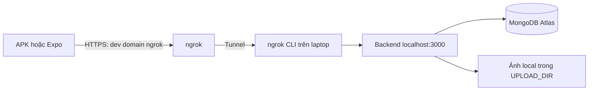

# Ngrok cho demo APK — thiết kế tối giản

Ngày 16/11/2026. Trạng thái: thiết kế/kế hoạch để người dùng duyệt, chưa triển khai.

## Mục tiêu

APK gọi được backend laptop khi đổi Wi-Fi/hotspot mà không sửa IP hoặc build lại
chỉ vì IP LAN thay đổi. Ưu tiên cấu hình, không bổ sung cơ chế dò mạng trong app.

## Phương án đã chọn

Người dùng đã chọn ngrok sau khi so sánh discovery LAN và tunnel. Dùng ngrok CLI
bên ngoài project với **dev domain gắn tài khoản**, chuyển tiếp HTTPS tới localhost:3000.
Giữ nguyên backend NestJS, MongoDB Atlas, thư mục ảnh, JWT, API và nghiệp vụ.



Ngrok xử lý đường kết nối khi IP mạng laptop thay đổi; app dùng URL HTTPS cố định.
Backend và ngrok phải đang chạy, laptop/điện thoại có Internet. Nếu agent mất kết nối
khi đổi mạng, chờ kết nối lại hoặc chạy lại `ngrok http 3000`, kiểm health trước khi demo.
Không cam kết kết nối không gián đoạn trong lúc chuyển mạng.

## Vì sao ít thay đổi

- `src/constants/config.ts` đã ưu tiên EXPO_PUBLIC_API_URL.
- `src/services/api.ts` đã dùng API_URL cho request và ghép URL ảnh tương đối.
- ProductImage dùng resolver đó. Health trên màn đăng nhập cũng dùng API_URL.
- Backend đã có /health và phục vụ /uploads; không cần route riêng cho ngrok.

**Mặc định không sửa file TypeScript/JavaScript và không thêm npm dependency.**
Không thêm màn nhập IP, mDNS, quét subnet, ngrok SDK, proxy riêng hoặc script khởi động.
Không thay dữ liệu, tài khoản, Mongo URI hay UPLOAD_DIR để đổi transport.

## Cấu hình cần thiết

1. Cài ngrok CLI cho Windows từ nguồn chính thức; người dùng tự đăng nhập/lưu authtoken
   qua `ngrok config add-authtoken <token>`. Token ở cấu hình ngrok của máy, không ở Git/app.
2. Bật backend bằng lệnh Node nạp Server/backend/.env hiện có; giữ cùng JWT_SECRET và
   UPLOAD_DIR đã dùng. Bật ngrok bằng `ngrok http 3000` ở terminal thứ hai.
3. Lấy chính xác Forwarding URL HTTPS/dev domain trong dashboard hoặc CLI, không tự đặt
   tên ví dụ. Free account hiện dùng domain được cấp (`ngrok-free.app` hoặc `ngrok-free.dev`),
   không cần mua/reserve custom domain. Kiểm URL giữ nguyên sau restart.
4. Expo local: EXPO_PUBLIC_API_URL trong App/InventorySupport/.env.local là URL đó,
   không thêm :3000 hoặc /api. Restart Expo với --clear sau đổi cấu hình.
5. APK: profile preview trong eas.json khai báo cùng URL; .env.local bị Git bỏ qua nên
   không phải nguồn cấu hình bảo đảm cho cloud build. app.json thêm android.package nếu
   còn thiếu; giữ nguyên plugin/cấu hình hiện có. HTTPS không cần thêm usesCleartextTraffic.

eas.json dự kiến (URL là placeholder, chỉ được build sau khi thay bằng domain thật):

```json
{
  "build": {
    "preview": {
      "distribution": "internal",
      "environment": "preview",
      "env": {
        "EXPO_PUBLIC_API_URL": "https://<dev-domain-ngrok-thuc-te>"
      },
      "android": { "buildType": "apk" }
    }
  }
}
```

Package Android đề xuất `com.inventorysupport.app`, cố định sau khi cài bản đầu.
Giữ các profile khác nếu EAS đã tạo chúng; không thêm developmentClient cho APK preview.
Cloud build/login/keystore thực hiện khi người dùng yêu cầu, không tự kích hoạt khi lập kế hoạch.

## File dự kiến

| File | Thay đổi |
| --- | --- |
| App/InventorySupport/.env.local | Local, đặt URL ngrok thực; không commit |
| App/InventorySupport/eas.json | Profile preview APK và URL public cho cloud build |
| App/InventorySupport/app.json | Chỉ thêm android.package khi chuẩn bị APK, giữ plugin cũ |
| docs/NGROK_SETUP.md | Cài một lần, lệnh chạy, kiểm tra, giới hạn, quay về LAN |
| README.md | Dẫn tới hướng dẫn ngrok và phân biệt LAN/HTTPS APK |

Không sửa package.json, request/image helper, auth hoặc schema theo phương án mặc định.

## Kiểm chứng và nhánh lỗi

- /health phải trả JSON có status=ok, không chỉ HTTP 200 hoặc HTML trang trung gian.
- Đăng nhập và đọc danh sách sản phẩm đúng quyền; kiểm yêu cầu không token bị chặn.
- Tải ít nhất một ảnh qua cùng hostname, Content-Type image/* và hiển thị ảnh trong app.
- Restart ngrok giữ domain; tắt ngrok làm app báo mất kết nối, không đổi dữ liệu.
- Điện thoại dùng 4G/5G hoặc Wi-Fi khác laptop vẫn đăng nhập/đọc ảnh; thử đổi Wi-Fi laptop
  rồi kết nối lại, APK tiếp tục dùng URL cũ sau khi tunnel sẵn sàng.
- Không gửi lặp thao tác ghi kho khi mất phản hồi; kiểm lịch sử trước retry như nghiệp vụ cũ.
- Theo tài liệu hiện tại, programmatic API không bị browser interstitial. Không thêm
  ngrok-skip-browser-warning hoặc đổi User-Agent trước khi tái hiện lỗi. Nếu có HTML cảnh báo,
  dừng bước build, xác định chính xác luồng (health/API/ảnh) rồi đề xuất bản sửa nhỏ có test;
  không che bằng response.ok hoặc parse HTML thành dữ liệu thành công.

## Điều kiện demo và giới hạn

Endpoint được truy cập qua Internet. Trước mở tunnel, người dùng đặt JWT_SECRET riêng và
đổi mật khẩu các tài khoản demo đang được công bố trong repo bằng chức năng hiện có;
không đưa password mới/authtoken vào app hoặc tài liệu. App còn gợi ý mật khẩu demo cũ,
nên khi đã đổi phải nhập mật khẩu mới thủ công; không bắt buộc sửa UI để làm ngrok.
Ảnh tĩnh hiện được truy cập theo URL, không bổ sung lớp auth ảnh trong phạm vi này.

Ngrok không thay hosting, không giữ backend chạy khi laptop ngủ/tắt, không làm Atlas
truy cập được khi mạng mới bị Atlas chặn. Nếu đổi public IP làm mất kết nối Mongo,
xử lý Network Access Atlas riêng, không mở toàn bộ dải IP chỉ để tránh cấu hình.
Gói free có quota; polling thông báo 30 giây và ảnh đều tính vào lưu lượng/request.
Không cam kết URL tồn tại sau khi xóa/thay tài khoản/domain; đổi domain cần cập nhật
cấu hình và build lại APK nếu chưa có cơ chế cập nhật khác.

## Tài liệu nguồn đã đối chiếu

- https://ngrok.com/docs/share-localhost/quickstart
- https://ngrok.com/docs/pricing-limits/free-plan-limits
- https://docs.expo.dev/build-reference/apk/
- https://docs.expo.dev/eas/json/

Thiết kế không phụ thuộc số quota cố định; kiểm dashboard/tài liệu ngrok khi triển khai.
